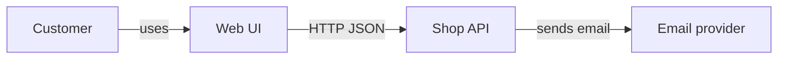

# Architecture

The customer browses and orders through the web UI.

The web UI is static HTML in public/ that calls the shop API.

The shop API is a node:http service that holds users and orders.

The email provider delivers order emails sent by the shop API.
