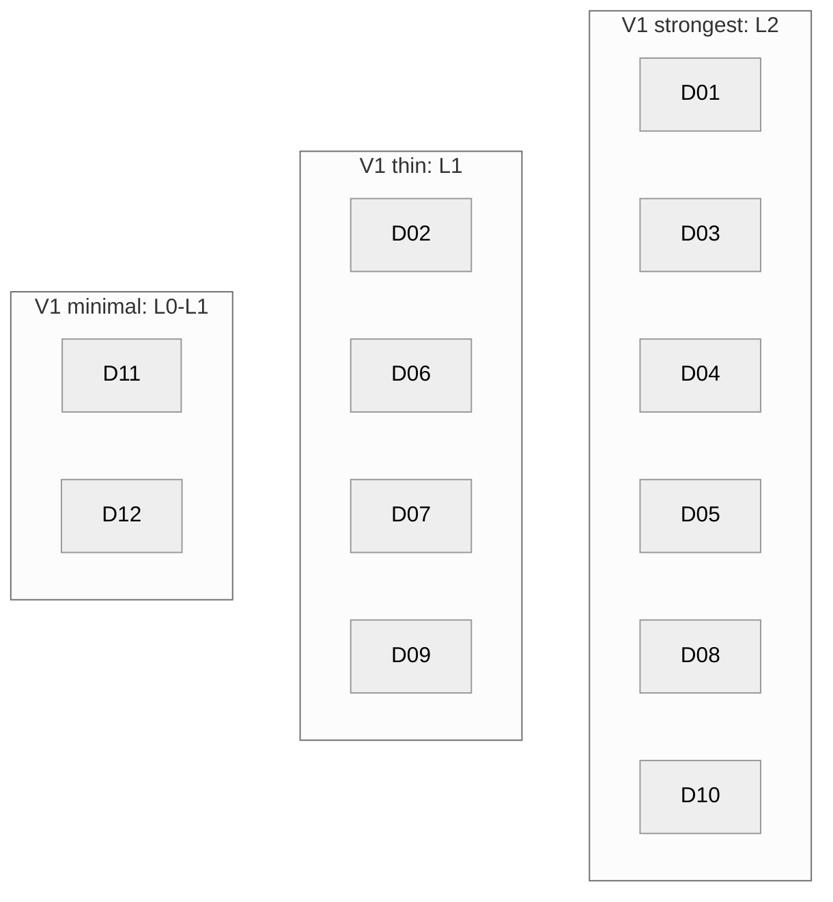

# 02 — Feature Inventory and 12-Domain Mapping

| Field | Value |
|---|---|
| Status | Draft for review |
| Baseline | `main` @ `51bfc3a` (1.6.1) |
| Date | 2026-11-23 |
| Related | [01 Audit](01-current-state-audit.md) · [05 Architecture §6](05-architecture-specification.md#6-capability-registry-and-catalog-contracts) · [07 Migration](07-migration-strategy.md) |

## 1. Purpose and scope

This document lists every V1 capability with a verified status and maps each existing asset to the
12 V2 capability domains. [07 Migration](07-migration-strategy.md) uses it to make sure no V1 feature
is lost.

Statuses follow [01 §1.1](01-current-state-audit.md#11-status-vocabulary). Finding IDs (`F-xx`) refer
to [01](01-current-state-audit.md).

**Out of scope:** proposing new V2 assets. Those are in [05 §6](05-architecture-specification.md#6-capability-registry-and-catalog-contracts).

## 2. V1 capability inventory

### 2.1 CLI and installation

| # | Capability | Status | Evidence / notes |
|---|---|---|---|
| C-01 | Interactive project creation (9 prompts) | EXISTING | `bin/cli.js:195-353` |
| C-02 | Non-interactive mode `-y` with defaults | EXISTING | `bin/cli.js:211-326` |
| C-03 | Project types `backend`, `frontend`, `fullstack`, `mobile` | EXISTING | `bin/cli.js:216-222` |
| C-04 | Framework choice through prompts (express/nestjs, nextjs/vite, expo/cli) | EXISTING | `bin/cli.js:226-286` |
| C-05 | Framework choice through `-f` flag | PARTIAL: flag ignored | F-04 |
| C-06 | UI library overlay (`shadcn`, `antd`, `chakra`, `semantic`) with dependency merge and Tailwind patch for antd | EXISTING | `mergeUIConfig`, `mergeTailwindConfig` |
| C-07 | Rule tier selection (`starter`/`standard`/`strict`) | PARTIAL: not written to CLAUDE.md | F-05, F-19 |
| C-08 | Database selection | PARTIAL: ignored by templates | F-06 |
| C-09 | Author placeholders `{{PROJECT_NAME}}`, `{{AUTHOR_NAME}}`, `{{AUTHOR_EMAIL}}`, `{{TIER}}`, `{{DATABASE}}` | EXISTING (`{{DATABASE}}` unused in templates) | `replacePlaceholders` |
| C-10 | Download of `.claude/` configuration | PARTIAL: unpinned, network-only | F-07 |
| C-11 | Optional honesty rule (`-H`) | EXISTING: removes `rules/honesty.md` when not selected | `bin/cli.js:411-416` |
| C-12 | Optional CodeGraph install (`-c`) | EXISTING (delegates to a third-party CLI; benefits UNVERIFIED) | `bin/cli.js:454-463`, F-28 |
| C-13 | git init and initial commit | EXISTING (failure mode UNVERIFIED) | F-11 |
| C-14 | Setup into an existing project | MISSING in CLI; manual `degit` or `make copy` only | F-10 |
| C-15 | Install `.agents/skills` | MISSING in CLI | F-09 |
| C-16 | Dry-run, diff, backup, rollback, manifest, update | MISSING | F-10 |
| C-17 | Alternative initializers `scripts/create-project.js`, `scripts/init.sh`, `make init` | EXISTING (divergent, not shipped) | F-13 |
| C-18 | `AGENTS.md` compilation from `.agents/skills` | EXISTING (exceeds Codex default size) | F-23 |

### 2.2 Configuration pack (`.claude/`, `.agents/`)

| Asset type | Count | Status | Notes |
|---|---|---|---|
| Agents (`.claude/agents/`) | 15 | PARTIAL | 4 have no frontmatter and are not registered (F-15) |
| Commands (`.claude/commands/`) | 9 | EXISTING | 3 have no frontmatter (F-16) |
| Claude skills (`.claude/skills/`) | 6 | EXISTING | Non-slug names (F-17) |
| Agent Skills (`.agents/skills/`) | 6 | EXISTING | Open format; Codex-discoverable (F-23) |
| Rules (`.claude/rules/`) | 19 files | EXISTING | All auto-loaded; one project-specific (F-18) |
| References (`.claude/references/`) | 7 | EXISTING | Checklists; loaded only when referenced |
| Hooks (`.claude/hooks/`) | 7 | PARTIAL | Very likely inert (F-20) |
| MCP server configs | 16 + minimal set | PARTIAL | Not read by the host (F-22) |
| `settings.json` permissions | 1 | PARTIAL | Machine paths, broad allow-list (F-08, F-21) |
| Application templates | 7 | EXISTING | F-25 |
| UI overlays | 4 | EXISTING | F-25 |
| Examples | 4 sets | EXISTING (repo only) | F-26 |

### 2.3 Detailed asset list

**Agents:** `backend`, `code-reviewer`, `copywriter-seo`, `frontend`, `mobile`, `project-manager`,
`qa`, `security-auditor`, `systems-architect`, `test-engineer`, `ui-ux-designer`, plus four resolvers
with no frontmatter: `node-build-resolver`, `prisma-resolver`, `react-build-resolver`,
`react-native-resolver`.

**Commands:** `build`, `debug`, `deploy`, `fix-issue`, `plan`, `review`, `simplify`, `spec`, `test`.

**Claude skills:** `code-review`, `data-transform`, `deploy`, `incremental-implementation`,
`security-review`, `tdd`.

**Agent Skills:** `code-review`, `nestjs-backend`, `nodejs-backend`, `react-frontend`,
`react-native-mobile`, `tdd`.

**Rules:** `api-conventions`, `clean-code`, `code-style`, `database`, `error-handling`, `git-workflow`,
`honesty` (optional), `monitoring`, `naming-conventions`, `project-structure`, `python-patterns`,
`react-native` (undocumented, project-specific), `security`, `sql-patterns`, `system-design`,
`tech-stack`, `testing`, `typescript-patterns`, plus `TIERS.md`.

**References:** `accessibility-checklist`, `external-skills` (repo only), `mobile-performance-checklist`,
`mobile-release-checklist`, `performance-checklist`, `security-checklist`, `testing-patterns`.

**Hooks:** `PreToolUse/security-scan`, `PreToolUse/lint-check`, `PostToolUse/auto-format`,
`PostToolUse/typescript-check`, `PostToolUse/console-log-warn`, `Lifecycle/session-summary`,
`Lifecycle/cost-tracker`.

## 3. 12-domain coverage of existing assets

Coverage levels used throughout V2 (defined normatively in [05 §6.8](05-architecture-specification.md#68-domain-depth-levels)):

| Level | Meaning |
|---|---|
| L0 | Domain and capabilities defined in the catalog; no executable guidance |
| L1 | At least one Skill or Rule gives usable guidance for a core capability |
| L2 | At least one Workflow covers a core capability end to end, with an Agent assignment |
| L3 | L2, plus benchmark tasks and quality gates that produce evidence |

V1 has no catalog, so each domain's **V1 level** below is an estimate of the guidance that exists,
not a catalog status. The "Gaps" column lists spec capabilities with no V1 asset.

| # | Domain (V2 ID) | Existing V1 assets | V1 level | Main gaps |
|---|---|---|---|---|
| D01 | Product & Business (`product-business`) | agent `project-manager`; commands `spec`, `plan` | L2 (PRD → plan) | Discovery, BRD, stakeholder and business process analysis, release planning |
| D02 | Design & UX (`design-ux`) | agent `ui-ux-designer`; ref `accessibility-checklist`; UI overlays | L1 | UX research, IA, wireframing, design tokens, usability review workflow |
| D03 | Frontend (`frontend`) | agents `frontend`, `react-build-resolver`*; skill `react-frontend`; ref `performance-checklist`; templates `frontend-nextjs`, `frontend-vite`, `fullstack`; UI overlays | L2 (React only) | Vue, Angular; SSR/SSG strategy guidance beyond Next.js; frontend testing workflow |
| D04 | Backend (`backend`) | agents `backend`, `node-build-resolver`*, `prisma-resolver`*; skills `nodejs-backend`, `nestjs-backend`; rules `api-conventions`, `database`, `error-handling`, `sql-patterns`, `python-patterns`, `system-design`; templates `backend`, `backend-nestjs`, `fullstack` | L2 (Node only) | Java, Go, .NET guidance; messaging, distributed systems workflows |
| D05 | Mobile (`mobile`) | agents `mobile`, `react-native-resolver`*; skill `react-native-mobile`; rule `react-native` (project-specific); refs `mobile-performance-checklist`, `mobile-release-checklist`; templates `mobile-expo`, `mobile-cli` | L2 (RN only) | Native iOS/Android, Flutter, offline-first, mobile security |
| D06 | Data & AI/ML (`data-ai`) | skill `data-transform`; rules `database`, `sql-patterns` | L1 (data formats only) | Pipelines, data quality and governance, ML, LLM integration, RAG, vector search, MLOps |
| D07 | DevOps, Cloud & SRE (`devops-sre`) | skill + command `deploy`; rule `monitoring`; rule `git-workflow` | L1 | CI/CD templates, IaC, Kubernetes, incident response, DR, FinOps |
| D08 | Quality Engineering (`quality`) | agents `qa`, `test-engineer`; skills `tdd` (×2), `incremental-implementation`; command `test`; rule `testing`; ref `testing-patterns` | L2 | Test data management, performance and API testing workflows, quality reporting with evidence |
| D09 | Security & Compliance (`security-compliance`) | agent `security-auditor`; skill `security-review`; rule `security`; ref `security-checklist`; hook `security-scan` (inert, F-20) | L1–L2 | Threat modelling workflow, dependency security, privacy and compliance mapping, enforced secret scanning |
| D10 | Architecture & Technical Leadership (`architecture-leadership`) | agents `systems-architect`, `code-reviewer`; skill `code-review` (×2); command `review`, `simplify`; rules `system-design`, `tech-stack`, `clean-code`, `code-style`, `project-structure`, `naming-conventions`, `typescript-patterns` | L2 | ADR management workflow, tech-debt management, cross-domain coordination |
| D11 | Documentation & DevEx (`docs-devex`) | rule `honesty`; `scripts/compile-skills.js`; agent `copywriter-seo` (marketing copy, not technical docs) | L0–L1 | API and architecture docs, onboarding, changelog and release notes, docs validation |
| D12 | Integration & Automation (`integration-automation`) | MCP config collection (reference only, F-22); CodeGraph installer; hooks (inert) | L0–L1 | Working MCP install, workflow automation, event-driven integrations, automation reliability |

\* No frontmatter, so not registered as a subagent (F-15).

## 4. Observations that drive V2 design

1. **Agents mirror job titles.** V1 has 15 agents for roughly 6 domains. Extending one agent per role
   to all 12 domains would produce more than 80 agents. The V2 decision (ADR-004) is capability-driven
   agents; see [05 §6.6](05-architecture-specification.md#66-canonical-agent-set-proposed).
2. **The stack opinion is global.** `tech-stack.md` (35 KB) prescribes one stack for every project.
   This conflicts with the universal audience (see [10 conflict CF-03](10-architecture-decisions.md#3-conflicts-between-the-specification-and-the-repository)).
3. **Valuable content is locked in the Claude-specific layout.** Most V1 assets (agents, skills,
   rules, references, commands) are Markdown whose bodies are largely provider-neutral. Only the
   frontmatter and file locations are host-specific. This content can become canonical catalog
   content with adapter-generated wrappers ([07](07-migration-strategy.md)). No per-file
   neutrality audit has been done yet.
4. **`.agents/skills` is already a cross-host bridge** (F-23). V2 should build on it on purpose.

## 5. Acceptance criteria

- [x] Every V1 asset type and every individual asset is listed.
- [x] Every asset is mapped to at least one of the 12 domains, or to "installer/CLI".
- [x] Gaps per domain are listed against the capabilities in [EXECUTION-SPECIFICATION §4](EXECUTION-SPECIFICATION.md).
- [ ] A maintainer has confirmed that no V1 asset is missing. **Pending.**
