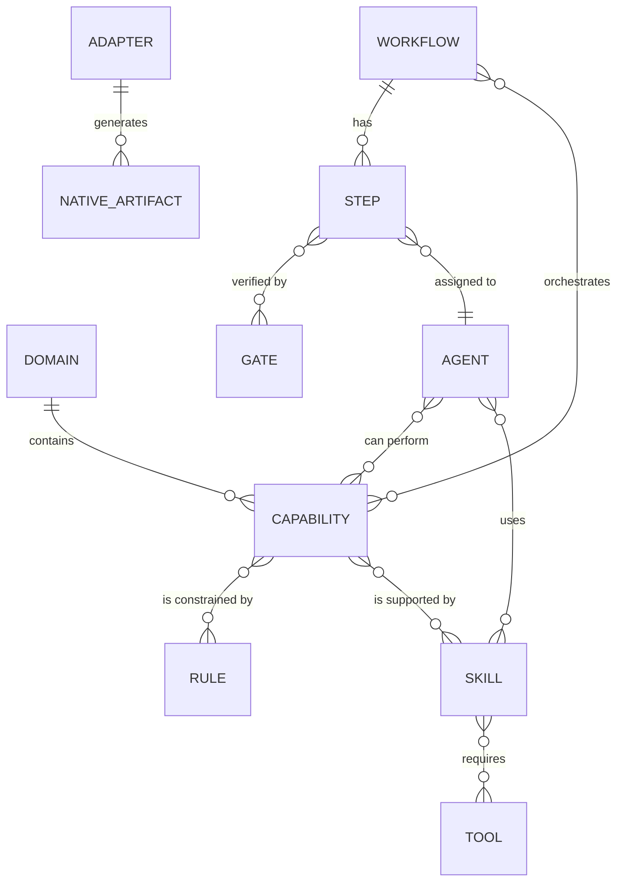
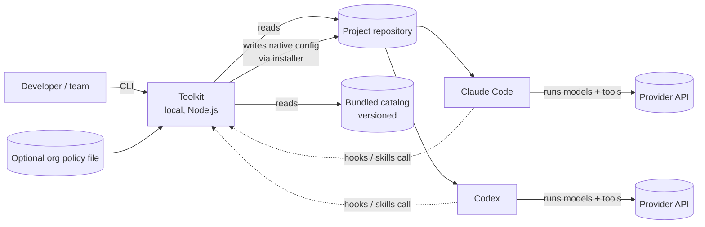
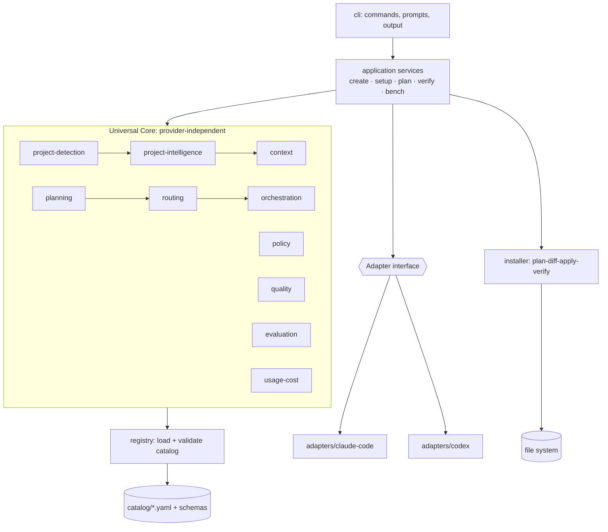
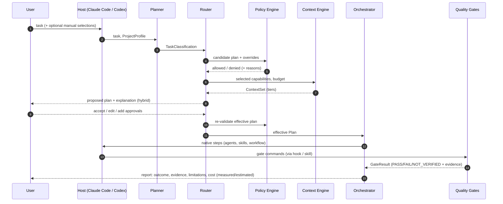
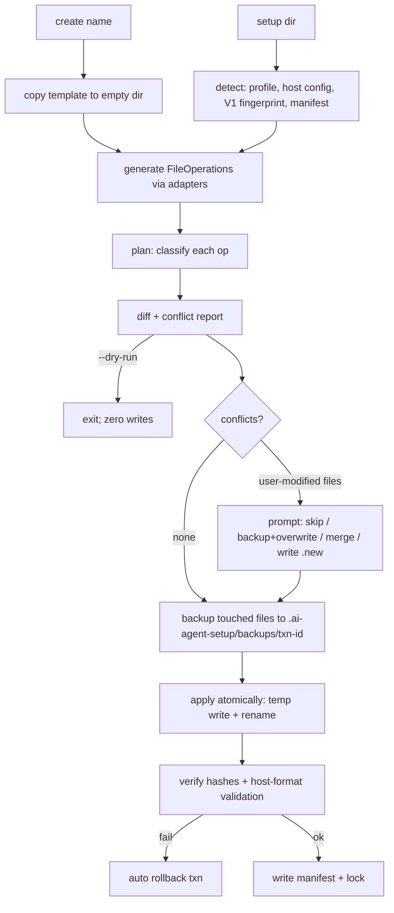

# 05 — Architecture Specification

| Field | Value |
|---|---|
| Status | Draft for review. Principles approved by ADR-001–008; component designs are proposals. |
| Date | 2026-11-23 |
| Related | [04 Product](04-product-specification.md) · [06 Repository](06-repository-structure.md) · [09 Testing](09-testing-and-benchmark-strategy.md) · [10 ADRs](10-architecture-decisions.md) |

> Everything in this document is `PLANNED` unless it is marked `EXISTING`. Host facts (§10) were
> verified against official documentation on 2026-11-23 and must be re-verified when implementation
> starts.

## 1. Purpose and scope

This document defines the V2 architecture: the Universal Core, the canonical catalog contracts, hybrid
orchestration, context, policy, the native adapters (Claude Code and Codex), the safe installer, and
the quality system. It is the reference for implementation.

**Out of scope:** concrete code, final catalog content, host plugin or marketplace distribution
(future), UI beyond the CLI.

## 2. Terminology (canonical)

These definitions are normative for all V2 documents.

| Concept | Definition | Example |
|---|---|---|
| **Domain** | A major area of engineering responsibility; groups capabilities | `backend` |
| **Capability** | A specific, verifiable ability the system can perform within a domain | `backend.api-design` |
| **Agent** | An execution role with instructions, allowed tools and a model hint; performs tasks using skills | `implementer` |
| **Skill** | Reusable knowledge, instructions and procedures, loaded on demand | `skill.nodejs-backend` |
| **Rule** | A constraint or engineering standard; always applied or applied by scope | `rule.security` |
| **Workflow** | A defined sequence of steps, decisions and gates that may span domains | `wf.feature-delivery` |
| **Tool** | An executable capability (local command, host tool, MCP server) | `tool.npm-test` |
| **Adapter** | A provider-specific layer that translates canonical contracts into host-native artifacts | `adapter.codex` |
| **Profile** | A named preset of catalog selections and policy (V1 tiers become profiles) | `profile.standard` |
| **Plan** | The output of the router: the selected entities, the workflow and the gates for one task | `plan-2026…` |
| **Gate** | A verification step that returns PASS, FAIL or NOT_VERIFIED with evidence | `gate.unit-tests` |



Cardinalities follow EXECUTION-SPECIFICATION §5: one agent uses many skills, one skill is shared by
many agents, one workflow spans many domains, and one domain has many capabilities. **No entity is
created per job title** (ADR-004).

## 3. System context



- The toolkit never calls a model provider itself. Execution stays in the host (ADR-003, ADR-006).
- No component requires a network connection after install (ADR-005).

## 4. Layered architecture (modular monolith)



**Dependency rules** (enforced by a static check in CI, NFR-03):

1. `core/*` may import `registry`, `shared` and other `core` modules only through their public
   `index`. It may not import `adapters/*`, `installer`, `cli` or any host format.
2. `adapters/*` may import `core` types, `registry` and `shared`. Adapters do not import each other.
3. `installer` knows nothing about hosts. It applies a list of file operations produced by adapters.
4. `cli` is the only layer that performs interactive I/O.

## 5. Universal Core modules

| # | Module | Responsibility | Inputs → outputs | First phase |
|---|---|---|---|---|
| 1 | **Project Detection** | Deterministic scan of manifests: languages, frameworks, package managers, build tools, test runners, CI, signals, workspaces. Existing AI host config and the V1 fingerprint are detected by each adapter (`detectExistingConfig`), so the Core stays host-neutral | repo path → `ProjectProfile`; adapters → `HostConfigDetection` | 2.0 |
| 2 | **Project Intelligence** | Higher-level understanding: module map, ownership hints, risk areas, change impact for a file set | profile + repo → `ProjectModel`, `ImpactReport` | 2.1 |
| 3 | **Context Engine** | Selects instructions and knowledge to load under a byte/token budget; assigns load tiers (§8) | plan + model + budget → `ContextSet` | 2.0 static, 2.1 dynamic |
| 4 | **Task Planner** | Classifies a task (type, domains, risk, size) and decomposes it into steps | task text + model → `TaskClassification` | 2.1 |
| 5 | **Capability Registry** | Source of truth for domains, capabilities, agents, skills, rules, workflows and tools; loads and validates the catalog; answers queries | catalog → typed index | 2.0 |
| 6 | **Hybrid Agent Router** | Chooses the minimal capability, agent and skill set; merges user overrides; produces explanations (§7) | classification + overrides + policy → `Plan` | 2.1 |
| 7 | **Workflow Orchestrator** | Turns a plan into an ordered step graph with gates and approval points, and hands it to the adapter for native execution; tracks step state from host callbacks (hooks) | `Plan` → `ExecutionGraph`, step log | 2.0 static, 2.1 dynamic |
| 8 | **Knowledge Registry** | Indexes content bodies (skill text, rules, references) and project knowledge (ADRs, docs) with metadata for retrieval; complements the Capability Registry, which holds metadata only | catalog + repo docs → `KnowledgeIndex` | 2.0 catalog, 2.1 project |
| 9 | **Policy Engine** | Evaluates layered policy (§9); validates plans and overrides; emits native permission intents | policies + plan → decision with reasons | 2.0 |
| 10 | **Quality Gate Engine** | Runs gate commands, captures evidence, returns PASS, FAIL or NOT_VERIFIED (§12) | gates + repo → `GateResult[]` | 2.0 contract, 2.2 engine |
| 11 | **Evaluation Engine** | Runs routing and context evaluation sets and benchmarks; compares arms ([09](09-testing-and-benchmark-strategy.md)) | eval suites → reports | 2.1 routing, 2.2 bench |
| 12 | **Cost & Usage Tracking** | Estimates plan cost from context size and step count; ingests usage the host exposes locally; reports cost per accepted outcome; labels every figure `measured` or `estimated` | plan + host logs → `UsageReport` | 2.1 estimate, 2.2 measured |

Boundaries: modules communicate through typed value objects (`ProjectProfile`, `Plan`, …) defined in
`core/contracts`. No module keeps global mutable state. Persistence is limited to the installer
manifest and local run logs under `.ai-agent-setup/` (§11).

## 6. Capability Registry and catalog contracts

### 6.1 Format and validation

- Catalog entries are **YAML files** validated against **JSON Schema (2020-12)** files in
  `catalog/schemas/` (proposed ADR-010).
- One entity per file: `catalog/<kind>s/<id>.yaml`. Long-form bodies (skill or rule text) live next
  to the entry as Markdown (`<id>.md`).
- `catalog validate` checks: schema conformance, unique IDs, resolvable references, no dependency
  cycles, adapter support declared for every `stable` entry, and status rules (§6.4). Gate IDs
  (`gate.*`) are pattern-checked only until the Quality Gate Engine defines a gate registry
  (W2.2-01). Implemented in `src/registry/` (W2.0-04).

### 6.2 Common envelope (all kinds)

```yaml
apiVersion: catalog.ai-agent-setup/v1     # contract version (see §6.5)
kind: Capability                          # Domain|Capability|Agent|Skill|Rule|Workflow|Tool|Profile
id: backend.api-design                    # stable, kebab-case, dot-namespaced; never reused
name: API design
description: Design resource-oriented HTTP APIs with versioning, errors and pagination.
version: 1.0.0                            # semver of this entry's content
category: backend                         # owning domain id (for Domain: "domain")
status: experimental                      # draft|experimental|stable|deprecated|removed
dependencies:                             # other entity ids (typed refs)
  - rule.api-conventions
requiredContext:                          # what must be known/loaded before use
  projectSignals: [http-server]
  files: ["openapi.*", "src/**/routes/**"]
supportedAdapters:
  claude-code: native                     # native|emulated|unsupported
  codex: native
unsupportedReasons: {}                    # required per adapter marked unsupported on a stable entry
requiredPermissions:                      # canonical permission intents (§9.3)
  - fs.read
  - fs.write:src/**
inputSchema:  { $ref: "schemas/io/task-request.json" }
outputSchema: { $ref: "schemas/io/api-design-doc.json" }
validation:                               # how a result is accepted
  gates: [gate.openapi-lint, gate.unit-tests]
  reviewChecklist: skill.code-review#api
owners: [maintainers]
deprecation: null                         # {since, replacedBy, removalIn} when deprecated
```

### 6.3 Kind-specific fields

| Kind | Additional required fields |
|---|---|
| `Domain` | `purpose`, `roles[]` (descriptive only; roles never create agents), `capabilities[]`, `depthLevel` (§6.8) |
| `Capability` | `domain`, `skills[]`, `rules[]`, `defaultAgents[]`, `riskLevel` (low/medium/high), `costHint` (relative) |
| `Agent` | `purpose`, `capabilities[]`, `skills[]` (default load), `tools.allow[]`/`tools.deny[]` (canonical), `modelHint` (`fast`/`balanced`/`deep`, mapped by the adapter), `body` (instructions file) |
| `Skill` | `body`, `triggers` (description used for implicit invocation), `resources[]` (scripts, references), `disableImplicit` (bool) |
| `Rule` | `body`, `scope`: `always` or `paths: [globs]` or `capabilities: [ids]`, `enforcement`: `advisory`/`gate`/`policy` |
| `Workflow` | `steps[]` (`id`, `capability`, `agent`, `gates[]`, `approval` = `none`/`optional`/`required`), `entry` (manual command name), `domains[]`, `body` (procedure text; V1 command content) |
| `Tool` | `type` (command/mcp/host), `command` or `mcp` spec, `platforms[]`, `network` (bool); permissions use the envelope `requiredPermissions` |
| `Profile` | `includes` (statuses, ids, domains), `excludes.ids` (e.g. the opt-in honesty rule), `policy` (ref to `catalog/policies/`), `contextBudget` per adapter, `gates` (required set) |

### 6.4 Status lifecycle

`draft` → `experimental` → `stable` → `deprecated` → `removed`.

- `draft` entries are excluded from generated output.
- `experimental` entries are generated only when a profile opts in.
- `stable` entries require `supportedAdapters` for both initial adapters (either `native` or
  `emulated`, or an explicit `unsupported` with a reason), at least one validation gate or checklist,
  and golden tests.
- A `deprecated` entry must name `replacedBy` (or `null`) and `removalIn`, and stays for at least one
  minor version.

### 6.5 Versioning and compatibility rules

| Change | Entry `version` | Contract `apiVersion` |
|---|---|---|
| Wording or guidance improvement | patch | — |
| New optional field, new capability linked | minor | — |
| Removed or renamed field, changed semantics, ID change | major (new ID preferred) | — |
| Envelope or kind schema breaking change | — | `v1` → `v2`; the registry reads both for one major toolkit version |

- **IDs are permanent.** A renamed entity gets a new ID, and the old one is deprecated with
  `replacedBy`.
- Project overrides reference entries by `id@range` (for example `skill.tdd@^1`). Incompatible
  ranges fail validation with a message.

### 6.6 Canonical agent set (proposed)

A small set of reusable agents. Specialization comes from skills and rules selected per capability,
not from new agents. The list is a proposal for catalog review (OQ-04).

| Agent ID | Purpose | Primary domains |
|---|---|---|
| `agent.analyst` | Requirements, scope, stories, acceptance criteria | D01, D11 |
| `agent.designer` | UX flows, IA, UI and component specs, accessibility review | D02 |
| `agent.architect` | Architecture design and evaluation, ADRs, cross-domain coordination | D10, D06, D07 |
| `agent.implementer` | Code changes in any stack (frontend, backend, mobile, data, integration), guided by stack skills | D03–D06, D12 |
| `agent.tester` | Test strategy, test code, test data, quality reports | D08 |
| `agent.reviewer` | Five-axis code review, debt identification | D10, D08 |
| `agent.security-auditor` | Threat modelling, vulnerability and dependency review, compliance mapping | D09 |
| `agent.operator` | CI/CD, IaC, deployment, observability, incidents, cost | D07 |
| `agent.writer` | Technical, API and architecture docs, onboarding, release notes | D11 |

The V1 agents map to these plus skills; see [07 §2](07-migration-strategy.md#2-v1-asset-mapping).

### 6.7 Initial domain catalog (V2.0 foundation)

Capability IDs are `<domain-id>.<slug>`. All capabilities below are created in V2.0 with status
`experimental` or `draft`, and the depth level is tracked per domain (§6.8).

| # | Domain ID | Capabilities (slugs) |
|---|---|---|
| D01 | `product-business` | product-discovery, requirement-analysis, user-story-creation, acceptance-criteria, backlog-management, scope-definition, business-process-analysis, stakeholder-analysis, product-documentation, release-planning |
| D02 | `design-ux` | ux-research, user-journey-mapping, information-architecture, wireframing, ui-design, interaction-design, design-system-definition, design-token-management, accessibility-evaluation, usability-review |
| D03 | `frontend` | application-architecture, component-engineering, state-management, routing, api-integration, rendering-strategy (SSR/SSG/CSR), accessibility, performance-optimization, design-system-implementation, frontend-testing |
| D04 | `backend` | api-design, domain-modeling, service-architecture, authn-authz, database-design, caching, messaging, transactions, distributed-systems, reliability-scalability |
| D05 | `mobile` | native-development, cross-platform-development, mobile-architecture, navigation-state, offline-first, push-notifications, deep-linking, mobile-performance, mobile-security, app-distribution |
| D06 | `data-ai` | data-modeling, etl-elt, data-pipelines, data-quality, data-governance, analytics, machine-learning, model-evaluation, llm-integration, rag, vector-search, mlops |
| D07 | `devops-sre` | ci-cd, infrastructure-as-code, containerization, kubernetes, cloud-infrastructure, deployment-strategies, monitoring, logging-tracing, incident-response, disaster-recovery, reliability-engineering, cost-optimization |
| D08 | `quality` | test-strategy, test-planning, functional-testing, integration-testing, e2e-testing, api-testing, performance-testing, regression-testing, test-automation, test-data-management, quality-reporting |
| D09 | `security-compliance` | threat-modeling, secure-coding, vulnerability-assessment, dependency-security, authentication-security, authorization-review, secrets-management, privacy-assessment, compliance-mapping, security-testing, security-incident-analysis |
| D10 | `architecture-leadership` | architecture-design, architecture-evaluation, adr-management, technical-decision-making, code-review, technical-debt-management, system-design, engineering-standards, mentoring, cross-domain-coordination |
| D11 | `docs-devex` | technical-documentation, api-documentation, architecture-documentation, developer-onboarding, knowledge-management, changelog-generation, release-notes, documentation-validation, developer-workflow-optimization |
| D12 | `integration-automation` | api-integrations, mcp-integrations, workflow-automation, event-driven-integrations, tool-orchestration, internal-developer-tools, external-service-integration, automation-reliability |

Each `Domain` entry also records its `roles[]` exactly as listed in EXECUTION-SPECIFICATION §4. Roles
are descriptive and are used by the router to interpret tasks ("as a BA, …"). They never generate
agents.

### 6.8 Domain depth levels

| Level | Definition | Exit evidence |
|---|---|---|
| L0 Defined | Domain and all capabilities exist and validate; roles recorded | `catalog validate` passes |
| L1 Guided | ≥ 1 `stable` skill or rule for the domain's core capabilities, generated for both adapters | Golden tests for both adapters |
| L2 Orchestrated | ≥ 1 `stable` workflow with agent assignment and gates | Workflow contract test |
| L3 Evaluated | ≥ 3 benchmark tasks in the suite and gates producing evidence | Benchmark report ([09](09-testing-and-benchmark-strategy.md)) |

V2.0 commits **L0 for all 12 domains** and L1–L2 where V1 assets already exist. Targets per phase are
in [08 §6](08-implementation-roadmap.md#6-domain-depth-by-phase).

## 7. Hybrid orchestration

### 7.1 Pipeline



### 7.2 Modes

| Mode | Steps used from §7.1 | Notes |
|---|---|---|
| Automatic | All; step 8 auto-accepted when the plan's risk ≤ the profile threshold and no approval point is required | Low-risk default for beginners |
| Manual | 1, 4–5 (validation only), 10–15; the router does not select, it validates and fills only missing mandatory gates | User-specified entities are kept or rejected with a reason |
| Hybrid (default) | All; step 8 is interactive | Plan diff (proposal vs effective) is recorded |

### 7.3 Routing algorithm (V2.1)

1. **Classify** (deterministic rules first, model-assisted second): task type (feature, bug, refactor,
   docs, review, ops, analysis), risk level, size estimate, candidate domains with confidence.
2. **Select capabilities**: the smallest set that covers the classified intent. Capabilities whose
   `requiredContext` signals are absent from the profile are penalized.
3. **Select agents**: a set cover over the capabilities using `Agent.capabilities`. Prefer **one
   agent** unless the capabilities need disjoint tool permissions or an independent review
   (security-sensitive or `riskLevel: high` adds `agent.reviewer` or `agent.security-auditor`).
4. **Select skills and rules**: capability-linked skills plus `scope`-matching rules, ranked by
   relevance and pruned to the context budget (§8).
5. **Select workflow**: an explicit match (`wf.*` entry) or a synthesized linear workflow from the
   capability steps.
6. **Attach gates**: from capability `validation`, the profile's required gates, and mandatory policy
   gates.
7. **Estimate cost**: context bytes × steps × a per-model factor (labelled `estimated`).
8. **Explain** (§7.6).

**Minimality constraint:** a simple task (single domain, low risk, size S) must produce ≤ 1 agent and
≤ 3 skills. This is evaluated in V2.1 ([09 §4](09-testing-and-benchmark-strategy.md#4-routing-and-context-evaluation-v21)).

### 7.4 Override precedence

Highest wins. A lower layer can only **narrow** what a higher layer allows. It can never widen it.

| Rank | Layer | Can do | Cannot do |
|---|---|---|---|
| 1 | **Mandatory safety policy** (built-in, non-configurable) | Deny destructive or exfiltrating actions; require approval for irreversible operations | Be disabled by any layer |
| 2 | Organization policy (optional file) | Tighten tools, network, adapters, required gates; set budgets | Loosen rank 1 |
| 3 | Project policy and profile (`.ai-agent-setup/project.yaml`) | Choose profile, enabled domains and entries, required gates, approval points | Loosen ranks 1–2 |
| 4 | **User manual selections** for this task | Pick or exclude agents, skills, workflow and order; restrict tools; set budget; add approvals | Remove mandatory gates; enable denied tools |
| 5 | User edits to a proposed plan (hybrid) | Same as rank 4 | Same as rank 4 |
| 6 | Router proposal | Fill everything not specified above | Override ranks 1–5 |
| 7 | Catalog defaults | Baseline values | — |

### 7.5 Conflict resolution

| Conflict | Resolution |
|---|---|
| allow vs deny at different ranks | Higher rank wins; at the same rank, **deny wins** |
| Specific vs general rule at the same rank | More specific scope (path, capability) wins, unless it widens a higher rank |
| User excludes an agent that a mandatory gate requires | The plan is **invalid**. The router explains and proposes an alternative agent with the same capability. Nothing is re-added silently. |
| User selects a skill whose tool permissions are denied | Reject that selection with the policy reason; continue only with user confirmation |
| Budget below the estimated minimum cost | Hybrid: ask; Automatic: downgrade (fewer skills, `fast` model hint) and report; Manual: reject |
| Adapter cannot express a step natively | Use the `emulated` mapping if declared, otherwise mark the step `unsupported` and fail the plan before execution (§10.6) |

### 7.6 Explainability record

Every plan stores `.ai-agent-setup/runs/<plan-id>/explain.json` (local only). It answers the 8
questions in EXECUTION-SPECIFICATION §6.4:

```yaml
planId: 2026-11-23T10-15-02Z-7f3a
mode: hybrid
domains:      [{id: backend, why: "touches src/routes/*.ts; intent=feature", confidence: 0.86}]
agents:       [{id: agent.implementer, why: "covers backend.api-design, backend.database-design"}]
excluded:     [{id: agent.security-auditor, why: "riskLevel=low; no auth/secrets paths touched"}]
skills:       [{id: skill.nodejs-backend, why: "profile: express+prisma", bytes: 9120}]
rules:        [{id: rule.api-conventions, scope: "paths: src/routes/**"}]
assumptions:  ["existing tests run with `npm test`"]
tools:        {allow: [fs.read, fs.write:src/**, cmd:npm-test], approvalRequired: [cmd:npm-install]}
cost:         {estimate: {contextBytes: 21400, steps: 3}, label: estimated}
verification: [gate.build, gate.unit-tests, gate.lint]
overrides:    [{rank: 4, field: excludeAgents, value: [agent.reviewer]}]
policyDecisions: [{rule: safety.no-force-push, effect: deny}]
```

### 7.7 Implementation notes (V2.1 preview, 2026-11-24)

- **Classification is deterministic and lexical**, because the toolkit never calls a model
  (§3). Each capability is scored from its catalog name, slug and description (IDF-weighted) plus a
  curated phrase lexicon. Domains add up their two best capabilities. A secondary domain must score
  at least 70% of the best domain.
- **Task type** comes from weighted cue words. Without a cue, it is inferred from the owner of the
  main capability (writer → docs, tester → test, …), and the explanation records that as an
  assumption.
- **Plan status:**
  - `hybrid` plans are always `proposed`.
  - `automatic` plans are `ready`, or `needs-approval` when risk is high, an approval point applies
    or the budget is exceeded.
  - `manual` plans are `ready` unless approval of the plan was requested.
  - Blocking conflicts make a plan `invalid`.
- **Agents in plans are canonical ids.** Mapping them to the agent names each host has (for example
  V1 aliases) is part of W2.1-10.

## 8. Context Engine

**Objective:** load the smallest instruction set that preserves quality (NFR-09).

| Tier | Content | Native realization: Claude Code | Native realization: Codex |
|---|---|---|---|
| T0 Always | Core project instructions, mandatory safety summary, profile summary (≤ budget) | `CLAUDE.md` or `.claude/CLAUDE.md`; `.claude/rules/*.md` **without** `paths:` | Root `AGENTS.md` (within `project_doc_max_bytes`, default 32 KiB) |
| T1 Scoped | Rules that apply to file areas | `.claude/rules/*.md` with `paths:` frontmatter (loaded when matching files are read) | Nested `AGENTS.md` in subdirectories (loaded root → cwd) |
| T2 On demand | Skills (procedures, stack knowledge) | `.claude/skills/<id>/SKILL.md` (progressive disclosure) | `.agents/skills/<id>/SKILL.md` (documented repo path) |
| T3 Retrieved | References, ADRs, project docs | Linked files read on demand | Linked files read on demand |

Rules:

- Every generated T0 file has a **byte budget** checked at generation time (`doctor --context`
  reports measured bytes). V1 loads about 125 KB at T0 (F-18). V2 moves stack-specific rules to T1
  and T2.
- Content is never duplicated across tiers. A skill may reference a rule by link.
- In V2.1 the engine also ranks T2 and T3 items per task for the explanation record and for workflow
  steps that pass explicit context.

## 9. Policy Engine

### 9.1 Layers

The layers are ranks 1–3 of §7.4. Mandatory safety policy ships with the toolkit and is not
configurable.

### 9.2 Mandatory safety policy (minimum set)

| ID | Policy |
|---|---|
| safety.no-destructive-unapproved | `rm -rf`, `git reset --hard`, `git push --force`, `DROP`/`TRUNCATE`, `DELETE` without `WHERE`, `docker system prune` require explicit approval (aligns with the V1 CLAUDE.md "Sensitive Commands Policy", which V1 permissions contradict, F-21) |
| safety.no-secret-write | The installer never writes secrets; the secret-scan gate blocks writes that contain known secret patterns |
| safety.no-silent-overwrite | Installer writes to user-modified files require a diff and consent |
| safety.no-telemetry | No outbound transmission of source code or usage data |
| safety.publish-approval | `npm publish`, production deploy and pushes to protected branches require approval |

### 9.3 Canonical permission intents

Policies and entries use host-neutral intents, which adapters translate (§10):
`fs.read[:glob]`, `fs.write[:glob]`, `cmd:<tool-id>`, `cmd.pattern:<glob>`, `net.fetch[:domain]`,
`mcp:<server>[:tool]`, `vcs.commit`, `vcs.push`, `pkg.install`, `pkg.publish`.

### 9.4 Policy documents and matching (implemented, W2.0-07)

Policies are YAML files validated by `catalog/schemas/policy.schema.json`. The bundled catalog holds
`policy.safety` (mandatory, exactly one) and `policy.default-project` (project layer). Organization
and user layers are loaded from outside the catalog. A rule matches by:

- `commands`: token globs over every simple command in a command line. Chains (`&&`, `||`, `;`, `|`)
  are split; `sudo`/`env`/`VAR=value` prefixes are removed; scripts passed to `sh|bash|zsh|dash -c`
  are evaluated too. `*` alone matches any number of tokens, and `*` inside a token matches
  characters, so `--force-with-lease` does not match the `--force` token.
- `commandRegex` (whole command text), `contentRegex` (content being written) and `intents`
  (`pkg.publish` also matches `pkg.publish:<x>`).

Effective effect = most restrictive match across all layers (allow < ask < deny). Allow rules that
lose are returned as `ignoredAllows` with the winning rule, for the explanation record (§7.6).

## 10. Native adapters

### 10.1 Adapter interface

```ts
interface Adapter {
  id: 'claude-code' | 'codex';
  version: string;                                   // adapter semver
  detect(repo: RepoView, env: HostEnv): HostCompat;  // installed? version? existing config?
  supports(entry: CatalogEntry): 'native' | 'emulated' | 'unsupported';
  generate(sel: Selection, ctx: GenerationContext): FileOperation[]; // pure, no I/O
  mapPermissions(intents: PermissionIntent[]): FileOperation[];
  validate(ops: FileOperation[]): Diagnostic[];      // host-format validation
}
```

`generate` is **pure**: it returns file operations, and the installer applies them (§11). This makes
golden tests deterministic (NFR-07).

### 10.2 Host capability matrix (verified 2026-11-23)

| Concept | Claude Code | Codex (stable 0.171.0) |
|---|---|---|
| Project instructions | `CLAUDE.md` or `.claude/CLAUDE.md`; `@path` imports (max depth 4) | `AGENTS.md` per directory, root → cwd; `AGENTS.override.md`; combined limit `project_doc_max_bytes` (default 32 KiB) |
| Always-loaded rules | `.claude/rules/**/*.md` auto-loaded; `paths:` frontmatter scopes them | No separate rules concept; use `AGENTS.md` content or nested files |
| Agents | `.claude/agents/*.md`, frontmatter `name` and `description` required; `tools`, `disallowedTools`, `model`, `skills`, `mcpServers`, `hooks`, `permissionMode`, … | `.codex/agents/*.toml` (project) or `~/.codex/agents/`; required `name`, `description`, `developer_instructions`; may not set sandbox, approval or MCP |
| Skills | `.claude/skills/<name>/SKILL.md`; custom commands merged into skills (`.claude/commands/*.md` still works) | `.agents/skills/<name>/SKILL.md` (repo, documented), `~/.agents/skills`; required `name`, `description`; optional `agents/openai.yaml` |
| Manual workflow entry | Skill invoked as `/name` | Skill invoked as `$name` or `/skills`; custom prompts deprecated and user-level only |
| Hooks | `settings.json` `hooks`; JSON on **stdin**; block with exit 2 or `permissionDecision: "deny"`; events include `PreToolUse`, `PostToolUse`, `Stop` (per turn), `SessionEnd` | `.codex/hooks.json` or `[hooks]` in config (trusted projects only, reviewed via `/hooks`); JSON on stdin; exit 2 blocks; events include PreToolUse, PostToolUse, Stop, SessionStart, SessionEnd, PostModelRequest |
| Permissions | `permissions.allow`, `deny`, `ask` (`Bash(git *)`; MCP allow rules need a server prefix) | `sandbox_mode` (`read-only`, `workspace-write`, `danger-full-access`); `approval_policy` (`on-request`, `never`, granular); named permission profiles |
| Project config | `.claude/settings.json` (shared), `.claude/settings.local.json` | `.codex/config.toml` (**trusted projects only**); profiles are separate files since 0.134.0 |
| MCP | `.mcp.json` (project), `~/.claude.json` (user, local) | `[mcp_servers.<name>]` in `config.toml` |
| Plugins | `.claude-plugin/plugin.json` | `plugin.json` (`.codex-plugin/plugin.json` fallback); reads `.claude-plugin/marketplace.json` for compatibility |

Sources: Claude Code docs at `code.claude.com/docs/en/` (`hooks`, `settings`, `permissions`,
`sub-agents`, `skills`, `memory`, `mcp`, `plugins`). Codex docs at `learn.chatgpt.com/docs/`
(`agent-configuration/agents-md`, `config-file/*`, `build-skills`, `agent-configuration/subagents`,
`hooks`, `extend/mcp`, `plugins`), checked against `openai/codex` releases. Codex `.codex/skills` and
`~/.codex/skills` are scanned per the source code but are undocumented (`~/.codex/skills` is marked
deprecated); adapters must use `.agents/skills`.

### 10.3 Claude Code adapter (mapping)

| Canonical | Generated |
|---|---|
| T0 instructions + profile | `.claude/CLAUDE.md` (the V1 location) managed section between markers; user text outside the markers is preserved |
| Rule `scope: always` | `.claude/rules/<id>.md` |
| Rule `scope: paths` | `.claude/rules/<id>.md` with `paths:` frontmatter |
| Skill | `.claude/skills/<slug>/SKILL.md` (`name` = slug; `description` from `triggers`) |
| Workflow (manual entry) | `.claude/commands/<entry>.md` with `description` frontmatter (V1 layout; command files still work). Where a skill has the same name, the skill wins, as in V1, and generation reports `W_COMMAND_SHADOWED` |
| Agent | `.claude/agents/<slug>.md` with `name`, `description`, `tools`/`disallowedTools` from intents, `model` from `modelHint`, `skills` preload |
| Permission intents | `.claude/settings.json` `permissions.allow`/`deny`/`ask`; destructive patterns go to `ask` or `deny` |
| Gates and safety enforcement | `hooks` → `PreToolUse` (policy check, secret scan; exit 2 to block), `PostToolUse` (format/lint advisory), `SessionEnd` (usage log) |
| Tools (MCP) | `.mcp.json` entries, opt-in per server |

### 10.4 Codex adapter

| Canonical | Generated |
|---|---|
| T0 instructions | Root `AGENTS.md` managed section, **hard byte budget** (default 24 KiB, under the 32 KiB default limit) |
| Rule `scope: paths` | Nested `AGENTS.md` in the matching directory when the glob maps to a directory; otherwise folded into the relevant skill and reported as `emulated` |
| Skill | `.agents/skills/<slug>/SKILL.md` (shared path; V1 assets already use it, F-23) |
| Workflow (manual entry) | Skill in `.agents/skills/<entry>/` (invoked with `$entry`); renamed `<entry>-workflow` when a skill already uses the name |
| Agent | `.codex/agents/<slug>.toml` with `name`, `description`, `developer_instructions`, `model` from `modelHint` |
| Permission intents | `.codex/config.toml`: `sandbox_mode` and `approval_policy` from the policy profile; command-level denials enforced through a `PreToolUse` hook |
| Gates and safety | `.codex/hooks.json` (`PreToolUse`, `PostToolUse`, `SessionEnd`) |
| Tools (MCP) | `[mcp_servers.<name>]` in `.codex/config.toml`, opt-in |
| Trust | Setup reports that project `.codex/` config, hooks and agents load **only for trusted projects** and prints the trust step (MR-07) |

### 10.4.1 Implementation notes (W2.0-09/10, 2026-11-24)

Implemented in `src/adapters/{claude-code,codex}/generate.ts`. Facts re-verified on 2026-11-24
(Codex `rust-v0.171.0`/`main`, Claude Code docs) changed or refined these points:

- **Policy hook.** Both adapters install the same self-contained runtime
  (`<host>/hooks/ai-agent-setup/policy-check.cjs`, built from the Core policy engine, plus
  `policies.json`). It reads hook JSON from stdin.
  - Claude Code: returns `permissionDecision` ask or deny. Command:
    `node "$CLAUDE_PROJECT_DIR/.claude/hooks/ai-agent-setup/policy-check.cjs"`.
  - Codex: blocks with exit code 2 and a reason on stderr. Codex does **not** support `ask` (it
    treats it as a failed hook and continues), so ask is emulated as a block that tells the agent to
    get human approval. Codex reports shell commands as `Bash` and edits as `apply_patch`, with the
    patch text in `tool_input.command`. There is no project-root variable, so the command uses
    `$(git rev-parse --show-toplevel)`. Project hooks run only in trusted projects and after the
    user approves them in `/hooks` (`W_CODEX_TRUST`).
  - On malformed input the hook fails open with exit 1 and a visible error.
- **Claude Code permissions.** `settings.json` gets `permissions.ask` and `permissions.deny` only, with
  no `allow`. A middle `*` in a Claude rule needs text between spaces, so a variant without it is
  added (`Bash(git push --force *)` next to `Bash(git push * --force *)`). Patterns with a wildcard
  inside a token (`rm * -*r* *`) are enforced only by the hook, because Claude's `*` also matches
  spaces and would ask for unrelated commands.
- **Agents.** V1 aliases keep V1 behaviour (no tool limits). Canonical agents get `tools` and
  `disallowedTools` from their intents. Codex agents are `.codex/agents/<slug>.toml` with `name`,
  `description` and `developer_instructions`.
- **Scoped rules.** Capability-scoped rules become skills (Claude Code). All scoped rules become
  skills on Codex, because Codex has no scoped rule files. Both are reported as `emulated`.
- **Codex config.** `.codex/config.toml` gets a managed section with `sandbox_mode = "workspace-write"`
  and `approval_policy = "on-request"` (proposal OQ-10, not yet approved), plus enabled MCP servers.
- **Host smoke tests** (loading the output in real `claude` and `codex` binaries) are NOT_VERIFIED:
  neither binary was available where this was built.

### 10.5 Compatibility detection and adapter versioning

- `detect()` reads the host version (`claude --version`, `codex --version`) when available, and the
  existing config layout. If no host binary is installed, generation still works and the
  compatibility status is `NOT_VERIFIED`.
- Each adapter declares a **tested host range** (for example `codex >=0.171 <0.180`). Outside that
  range: warn, generate, and mark the install `compat: unverified` in the manifest.
- Adapter versions are semver and released with the toolkit. A breaking change in a generated layout
  is a major adapter bump, and migration is handled by `update` (§11).
- Host documentation is re-verified at every toolkit minor release (checklist in
  [09 §3.5](09-testing-and-benchmark-strategy.md#35-host-compatibility-checks)).

### 10.6 Unsupported capability behaviour

| `supports()` result | Behaviour |
|---|---|
| `native` | Generate the native artifact |
| `emulated` | Generate the declared fallback (for example a skill instead of an agent field) and list it in the install report |
| `unsupported` + optional entry | Skip with a warning in the report |
| `unsupported` + required by profile or policy | **Fail** generation for that adapter with a reason; never degrade silently |

## 11. Safe installer

### 11.1 Workflows



### 11.2 File ownership classes

| Class | Detection | Default action |
|---|---|---|
| Managed, unchanged | Path in manifest; hash = recorded hash | Update freely |
| Managed, user-modified | Path in manifest; hash ≠ recorded hash | Conflict → prompt (default: write `.new` + report) |
| Managed section in a shared file (`CLAUDE.md`, `AGENTS.md`, JSON or TOML keys) | Marker comments or recorded key paths | Replace only the managed section or keys; preserve the rest |
| Unmanaged existing | Path not in manifest, file exists | Never overwritten without explicit consent; backup is mandatory |
| New | Path does not exist | Create |

Structured merge applies to JSON (`settings.json`, `.mcp.json`) and TOML (`config.toml`): arrays of
permission rules are unioned, and policy denials are always kept.

### 11.3 Manifest and lock

`.ai-agent-setup/manifest.json` (committed):

```json
{
  "schema": "manifest/v1",
  "toolkitVersion": "2.0.0",
  "catalogDigest": "sha256:…",
  "adapters": {"claude-code": {"version": "1.0.0", "hostCompat": "verified|unverified"},
               "codex": {"version": "1.0.0", "hostCompat": "unverified", "trustRequired": true}},
  "profile": "standard",
  "files": [{"path": ".claude/skills/tdd/SKILL.md", "sha256": "…", "source": "skill.tdd@1.2.0",
             "class": "managed"}],
  "sections": [{"path": "CLAUDE.md", "marker": "ai-agent-setup:t0", "sha256": "…"}],
  "transactions": [{"id": "txn-20261123T101500Z", "op": "setup", "backup": "backups/txn-…"}]
}
```

`.ai-agent-setup/project.yaml` (committed) holds team choices: profile, enabled domains, overrides,
and approval points. Backups and runs live under `.ai-agent-setup/backups/` and
`.ai-agent-setup/runs/`, both git-ignored.

### 11.4 Guarantees (testable)

| Guarantee | Test |
|---|---|
| Dry-run writes nothing | Hash every file in the fixture repo before and after: identical |
| Idempotent | Second `setup` with the same inputs produces 0 operations |
| Rollback integrity | After `rollback`, managed and touched files are byte-identical to the pre-transaction state |
| Version pinning | Catalog content comes from the installed package; `catalogDigest` is recorded; `update --to <version>` is explicit |
| Integrity validation | `doctor` reports modified managed files, missing files and digest mismatches |
| No silent destruction | No code path deletes or overwrites unmanaged or user-modified files without a recorded consent |

### 11.5 Implementation notes (W2.0-11/12, 2026-11-24)

Implemented in `src/installer/` (installer core) and `src/app/setup.ts` (setup use case).

- **Planning** (`planInstall`) is read-only and is the dry-run. Changes are sorted by path and each
  carries a unified diff.
  - Write operations on an existing file not in the manifest are a conflict (`unmanaged`).
  - A managed file whose hash differs from the manifest is a conflict (`managed-modified`).
  - Sections and JSON merges into existing files are `merge` (user content kept), unless a managed
    section was edited by hand or the JSON is invalid; both of those are conflicts.
- **Conflict strategies** (`resolveConflicts`): `write-new` is the default. It writes
  `<path>.ai-agent-setup.new` next to the file and leaves the original untouched. Neither host loads
  these `.new` files: they are not `.md` or `SKILL.md`. The other strategies are `skip` and
  `backup-overwrite`. A plan with unresolved conflicts cannot be applied.
- **Apply** (`applyPlan`):
  1. Refuses if any target changed after planning.
  2. Writes a journal (`.ai-agent-setup/transactions/<txn>.json`) before each file.
  3. Backs up existing files to `.ai-agent-setup/backups/<txn>/`.
  4. Writes atomically (temporary file + rename) and verifies the hash.
  5. Writes the manifest last.

  Any failure restores the backups, deletes created files and directories, and marks the journal
  `rolled-back`. `.ai-agent-setup/.gitignore` excludes `backups/`, `transactions/` and `runs/`; the
  manifest is meant to be committed.
- **Rollback** undoes the latest transaction that is not rolled back; call it again to step further
  back. Without `force` it refuses when a file changed after the transaction wrote it.
- **Doctor** reports `MISSING`, `MODIFIED`, `SECTION_MISSING`, `SECTION_MODIFIED`, `INVALID_JSON` and
  `PENDING_TRANSACTION`.
- **Setup** (`runSetup`):
  - Adapter choice: the hosts already configured in the project, otherwise Claude Code. Default
    profile: `profile.standard`.
  - When nothing would change it applies nothing (`upToDate`), so a second run makes zero writes.
  - In a V1 project every V1 file stays byte-identical except `.claude/CLAUDE.md` (managed section
    appended) and `.claude/settings.json` (merged). The V1 `allow` rules are kept and reported as
    `W_V1_PERMISSIONS` rather than deleted.
  - The `pristine-v1` refinement of 07 §4.1 (replacing unmodified V1 files after confirmation) is
    not implemented yet.

## 12. Quality system

### 12.1 Gate result contract

```yaml
gate: gate.unit-tests
category: unit            # build|unit|integration|e2e|security|performance|accessibility|documentation|deployment-readiness
status: PASS              # PASS|FAIL|NOT_VERIFIED
measured: true            # false => estimate or not executed
evidence:
  - type: command
    command: "npm test -- --reporter=json"
    exitCode: 0
    startedAt: 2026-11-23T10:20:01Z
    durationMs: 8123
    artifact: .ai-agent-setup/runs/<plan-id>/gates/unit-tests.json
    summary: {passed: 142, failed: 0, skipped: 3}
reason: null              # required when FAIL or NOT_VERIFIED
```

Rules:

- **PASS requires at least one evidence item** with an executed command (exit code) or a machine-readable
  artifact.
- A gate whose command is missing, cannot run (tool not installed, no network, no device) or times out
  returns **NOT_VERIFIED** with a reason. It is never reported as PASS.
- Model self-assessment is not evidence for PASS. It may be attached as `type: review-note`.
- Reports keep `measured` values separate from `estimated` ones and never aggregate them together.

### 12.2 Verification categories and default gates

| Category | Default gate (adapts to the detected stack) | Evidence |
|---|---|---|
| Build | Detected build command (`npm run build`, `mvn -q package`, `go build ./...`, …) | exit code, log |
| Unit testing | Detected test runner | exit code + parsed counts |
| Integration testing | Configured integration command | exit code + counts |
| E2E testing | Playwright or configured command | exit code + report |
| Security | Secret scan of the diff; dependency audit (`npm audit --json` or equivalent) | findings JSON |
| Performance | Configured benchmark or budget check | measured values vs budget |
| Accessibility | Configured axe or Lighthouse command (web) | report |
| Documentation | Link check; required docs updated for changed public APIs | report |
| Deployment readiness | Composite: build + tests + security PASS; migrations reviewed | gate list |

Profiles map V1 tiers: `starter` requires build + unit; `standard` adds lint, security and coverage
≥ 80% when measurable; `strict` adds integration, coverage ≥ 95% and documentation. These thresholds
come from V1 `TIERS.md`; the profile names are kept for compatibility.

## 13. Cross-cutting concerns

| Concern | Approach |
|---|---|
| Privacy | Local logs only (`.ai-agent-setup/runs/`); no telemetry (ADR-005); no secrets in logs |
| Errors | Typed errors with codes; every installer failure triggers rollback of the current transaction |
| Logging | Structured JSON lines for runs; human-readable CLI output |
| Portability | Node.js, no shell-specific scripts in generated hooks (hooks call `node`-based scripts) |
| Supply chain | No runtime downloads during install (fixes F-07); dependencies minimal and pinned |

## 14. Acceptance criteria for this architecture

- [x] Core modules 1–12 defined with responsibilities and boundaries; dependency rules stated.
- [x] Versioned contracts for all entity kinds, plus validation and compatibility rules.
- [x] All 12 domains present in the initial catalog with capability IDs.
- [x] Hybrid modes, override precedence, conflict resolution and explanation record specified.
- [x] Both adapters mapped, with verified host facts, sources and the unsupported-capability behaviour.
- [x] Installer flows, ownership classes, manifest and testable guarantees specified.
- [x] Quality gate contract enforces evidence and NOT_VERIFIED semantics.
- [ ] Architecture review sign-off. **Pending.**
