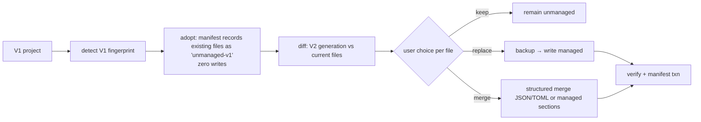

# 07 — Migration Strategy (V1 → V2)

| Field | Value |
|---|---|
| Status | Draft for review |
| Date | 2026-11-23 |
| Related | [02 Inventory](02-feature-inventory.md) · [03 Debt §3](03-technical-debt.md#3-migration-risks) · [05 §11 Installer](05-architecture-specification.md#11-safe-installer) · [06 Structure](06-repository-structure.md) |

## 1. Purpose, scope and principles

This document defines how V1 assets, CLI invocations and V1-generated projects move to V2 without
losing features or user data.

**Out of scope:** executing the migration.

Principles:

1. **Nothing is lost silently.** Every V1 asset in [02](02-feature-inventory.md) has a V2 destination
   or an explicit, announced deprecation.
2. **V1 projects keep working untouched.** V2 never modifies a V1 project unless the user runs
   `setup` (or `update`) in it.
3. **Adopt before change.** A V1 project is first *adopted* (recorded in a manifest, zero content
   changes). Changes are applied in a later, separate, reviewable transaction.
4. **Behaviour fixes are announced.** Fixes to V1 defects (F-04 to F-06) change output, and the
   release notes say so.

## 2. V1 asset mapping

### 2.1 Agents → canonical agents + skills

V1 agent names stay available as **alias entries** (`kind: Agent`, `aliasOf`, plus default skills),
so prompts like "use the Backend Developer" still resolve. Each alias keeps the V1 agent body
verbatim as its `body`, so the V1 layout can be regenerated. Aliases are `deprecated` from V2.1 and
kept through V2.x. `security-auditor` keeps its id as the canonical `agent.security-auditor` with
the V1 body. As implemented 2026-11-24, all migrated entries have `status: experimental` and
`version: 1.6.1`; `tests/catalog/v1-migration.test.ts` checks that every body equals the V1 source
without frontmatter.

| V1 agent | V2 canonical | Skills attached by the alias |
|---|---|---|
| frontend | agent.implementer | skill.react-frontend, rule.typescript-patterns |
| backend | agent.implementer | skill.nodejs-backend, skill.nestjs-backend (by profile) |
| mobile | agent.implementer | skill.react-native-mobile |
| systems-architect | agent.architect | rule.system-design, rule.tech-stack (as optional stack profile) |
| code-reviewer | agent.reviewer | skill.code-review |
| test-engineer, qa | agent.tester | skill.tdd (resource: testing-patterns) |
| security-auditor | agent.security-auditor | skill.security-review |
| project-manager | agent.analyst | wf.spec, wf.plan |
| ui-ux-designer | agent.designer | resource: accessibility-checklist (via the design-ux skills) |
| copywriter-seo | agent.writer | V1 body kept on the alias (no separate skill; changed from the earlier plan to avoid duplicating content) |
| react-build-resolver, react-native-resolver, node-build-resolver, prisma-resolver | agent.implementer | skill.build-resolve-react, skill.build-resolve-react-native, skill.build-resolve-node, skill.build-resolve-prisma (agent bodies become skills; this fixes the missing frontmatter, F-15) |

### 2.2 Other assets

| V1 asset | V2 entity | Notes |
|---|---|---|
| Commands `spec`, `plan`, `build`, `test`, `review`, `deploy`, `debug`, `simplify`, `fix-issue` | `wf.<name>` workflows, manual entry names unchanged | Invocation stays `/spec` in Claude Code; `$spec` in Codex |
| `.claude/skills/*` (6) + `.agents/skills/*` (6) | `catalog/skills/`: 10 unique skills. For `code-review` and `tdd` the body is the `.claude` version and the divergent `.agents` version is kept as resource `agent-skills-variant.md`; **merging them is pending manual review** | 10 unique skills (+4 resolver skills) |
| Rules (17 topic rules) | `catalog/rules/` with scope: `security`, `honesty`, `clean-code`, `code-style`, `git-workflow`, `error-handling` = always (T0, condensed); language and stack rules = `paths:` (T1) | Byte budget enforced ([05 §8](05-architecture-specification.md#8-context-engine)) |
| `tech-stack.md` | `catalog/profiles/stack-*` (optional) | Not mandatory in the universal default (TD-19) |
| `TIERS.md` | `profile.starter`, `profile.standard`, `profile.strict` | Thresholds preserved ([05 §12.2](05-architecture-specification.md#122-verification-categories-and-default-gates)) |
| `react-native.md` (project-specific) | Not migrated into the default catalog | Kept as `examples/project-rules/` (TD-08) |
| References (7) | Skill resources (T3) | — |
| Hooks (7) | Adapter-generated enforcement (stdin JSON) + gates | `cost-tracker` → usage tracking (V2.2); `session-summary` → `SessionEnd` run log |
| MCP configs (16) | `catalog/tools/mcp-*` + integration capability | Generated into `.mcp.json` or `[mcp_servers]`, opt-in |
| CodeGraph option `-c` | `tool.codegraph` (optional integration) | Unchanged behaviour; claims remain UNVERIFIED |
| Honesty rule `-H` | `rule.honesty` (opt-in, T0) | Unchanged |
| App templates (7) + UI overlays (4) | `templates/` | Unchanged, with `--db` fixed |

## 3. CLI compatibility

| V1 invocation | V2.0 behaviour | Change |
|---|---|---|
| `npx create-ai-agent-setup` | Interactive create (same prompts plus an adapter prompt) | Adds an adapter choice (default: detected, else `claude-code`) |
| `… my-app -t backend` | Same | — |
| `… -f nestjs` | **Honoured** (V1 ignored it) | Behaviour fix (F-04) |
| `… --db sqlite` | **Honoured in templates** | Behaviour fix (F-06) |
| `… -T strict` | Profile `strict` applied and written | Behaviour fix (F-05) |
| `… -u antd`, `-c`, `-H`, `-y` | Same | — |
| `… --version` | Reports the package version | Fix (F-02) |
| Existing directory as name | Error, as in V1, with a hint to use `setup` | Message only |

The V1 `.claude/` downloaded from GitHub is replaced by catalog generation from the installed package
(TD-02). `--adapter claude-code` reproduces the V1 file layout (paths and names), except for the fixes
above and the settings hygiene (TD-01).

### 3.1 Implemented behaviour (W2.0-13, 2026-11-24)

`bin/cli.js` is now an 8-line launcher for `dist/cli/main.js`. The V1 implementation stays in git
history and is frozen by `tests/characterization/`, which runs the CLI from commit `51bfc3a`. Checked
by `tests/e2e/cli.test.ts`:

- **Fixes:** `-f`, `--db` and `-T` are honoured; `--version` prints the package version under the
  published name.
- **Existing directory:** the error now points to `setup`.
- **Git:** a failed commit only warns, so a created project is never left half done (F-11).
- **Configuration source:** the AI configuration comes from the bundled catalog through the
  installer, with a manifest and rollback. The GitHub download is gone. With `--adapter codex` the
  project gets `AGENTS.md`, `.agents/skills` and `.codex/`.
- **Interactive mode:** the V1 prompt order is kept, with one new step (AI host: Claude Code,
  Codex or both).

Further behaviour changes that are **not** in the table above and must go in release notes:

- Unknown options are now an error. V1 ignored them silently.
- `create`, `setup`, `update`, `diff`, `doctor`, `rollback` and `catalog` are reserved as first arguments, so
  a project can no longer be named after them positionally. Use `create <name>`.
- `.claude/CLAUDE.md` holds a generated managed section instead of the V1 document; the V1
  "Maintainer" line is gone. Author details still fill `package.json` and README placeholders.
- `--db none` on templates that use Prisma keeps PostgreSQL and prints a warning. `--db mysql` or
  `sqlite` switches the provider and `DATABASE_URL`. Whether each template's schema migrates on
  those databases is UNVERIFIED.

## 4. Migration paths

### 4.1 Path A: V1-generated project → V2 (`setup` in a V1 project)

**V1 fingerprint:** `.claude/CLAUDE.md` containing the V1 header and workflow table, plus at least 3
known V1 rule filenames, plus optionally the commit message pattern `feat: initial project setup (`.
V1 files whose hash matches a known V1 release file are marked `pristine-v1` and can be replaced
safely after confirmation. Files that do not match are treated as user-modified.

### 4.2 Path B: manual copy users (`degit`, `make copy`)

These are treated as Path A. The fingerprint works without the commit message.

### 4.3 Path C: adding Codex to a V1 project

`setup --adapter codex` generates `AGENTS.md` (managed section), `.agents/skills/` (shared with Claude
Code when present) and `.codex/` config. It reports that the project must be trusted in Codex (MR-07).

### 4.4 Path D: V2.x → V2.y updates

`update` compares `catalogDigest` and adapter versions, plans operations by ownership class, and runs
the same diff, backup and apply pipeline.

**Implemented 2026-11-25:** `update [dir]` runs `setup` again with the adapters and profile recorded in
the manifest, after printing whether the catalog digest changed; it refuses a project without a V2
manifest.

## 5. Deprecations

| Item | Deprecated in | Removed in | Replacement |
|---|---|---|---|
| Runtime `degit` download of `.claude` | 2.0 (removed immediately) | 2.0 | Bundled catalog |
| `scripts/create-project.js`, `scripts/init.sh`, `make init`, `make copy` | 2.0 | 2.1 | `create`, `setup` |
| V1 agent names as primary entries | 2.1 (aliases) | 3.0 (earliest) | Canonical agents |
| `templates/.claude`, `templates/.agents` | 2.0 | 2.0 | Generated from `catalog/` |
| Non-standard `settings.json` keys (`context_window`, `*_dir`) | 2.0 | 2.0 | — (had no effect, F-21) |

## 6. Rollout plan

1. **V1.x patch track (proposed, needs approval):** fix TD-01 (settings), TD-04 (flags), TD-03 (hook
   input) and pin the config to the package version. This reduces risk for current users before V2
   ([08 §2](08-implementation-roadmap.md#2-v1x-maintenance-track-proposed)).
2. **Characterization snapshot:** capture V1 output golden files before refactoring
   ([09 §3.2](09-testing-and-benchmark-strategy.md#32-v1-characterization-tests)).
3. **V2.0 pre-releases** (`2.0.0-alpha`/`beta`, npm dist-tag `next`) with Path A tested on fixtures.
   Done: 2.0.0-alpha.0 on `next`, 2026-11-25; no beta (the maintainer released 2.0.0 the same day).
4. **V2.0 GA:** `latest` dist-tag moves to 2.0; 1.x is maintained for security fixes for a period to
   be decided (OQ-08).
   Done: 2.0.0 on `latest`, 2026-11-25; 1.x security fixes until 2027-05-25 (OQ-08).

## 7. Acceptance criteria

- [x] Every V1 asset from [02](02-feature-inventory.md) has a destination or a deprecation.
- [x] Every V1 CLI flag has defined V2 behaviour; behaviour changes are listed.
- [x] V1-generated projects have a zero-write adoption path.
- [x] Path A to D verified on fixtures (2026-11-25): A in `tests/e2e/setup.test.ts` (project made by the
  V1 CLI); B, C and D in `tests/e2e/migration-paths.test.ts` (V1 configuration copied by hand without
  the V1 commit; Codex added next to V1 without touching `.claude/`; a changed catalog updates managed
  files, keeps files the user changed with the new version written next to them, and rolls back byte
  for byte). **Gap against §4.1:** adoption is not recorded in the manifest (`unmanaged-v1` and
  `pristine-v1` exist only as types), so unmodified V1 files are not offered for safe replacement:
  today every differing V1 file is kept and the V2 version is written as `<file>.ai-agent-setup.new`,
  and only `.claude/CLAUDE.md` (managed section) and `.claude/settings.json` (structured merge) change.
