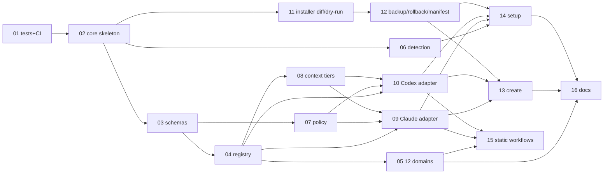

# 08 — Implementation Roadmap

| Field | Value |
|---|---|
| Status | Draft for review. Phase scope approved ([EXECUTION-SPECIFICATION §9](EXECUTION-SPECIFICATION.md)); sequencing proposed. |
| Date | 2026-11-23 |
| Related | [04 Product](04-product-specification.md) · [05 Architecture](05-architecture-specification.md) · [07 Migration](07-migration-strategy.md) · [09 Testing](09-testing-and-benchmark-strategy.md) |

## 1. Purpose and scope

This document defines a dependency-aware delivery sequence for V2.0, V2.1 and V2.2, with exit
criteria.

**Out of scope:** dates and staffing. Durations are not estimated, because there is no velocity data
for this codebase.

Work item IDs: `W0.x` (V1.x track), `W2.0-xx`, `W2.1-xx`, `W2.2-xx`.

## 2. V1.x maintenance track (proposed)

**Status: not approved.** This is recommended because the V1 defects affect current users now
([03](03-technical-debt.md)).

| ID | Item | Resolves |
|---|---|---|
| W0.1 | Remove machine paths; narrow the allow-list in shipped `settings.json` | TD-01 |
| W0.2 | Honour `-f`, `--db`, `--tier`; read version from `package.json` | TD-04, TD-16 |
| W0.3 | Hooks read stdin JSON; secret scan blocks with exit 2; lifecycle hooks on `SessionEnd` | TD-03 |
| W0.4 | Install config from the packaged `templates/.claude` instead of `degit` HEAD | TD-02 |

## 3. Phase V2.0: Foundation

**Goals:** Universal Core skeleton, canonical contracts, all 12 domains defined, Core separated from
adapters, safe installation, V1 compatibility.

| ID | Deliverable (spec #) | Depends on | Acceptance |
|---|---|---|---|
| W2.0-01 | Test foundation + CI + **V1 characterization snapshots** (14) | — | CI runs on 3 OSes; V1 golden files captured from `51bfc3a`-equivalent output |
| W2.0-02 | Modular Core skeleton, contracts, dependency rule check (1) | 01 | Core-imports-adapter check fails the build when violated |
| W2.0-03 | Versioned schemas: envelope + Domain, Capability, Agent, Skill, Rule, Workflow, Tool, Profile, manifest, GateResult contract (3, 5) | 02 | Schemas published in `catalog/schemas/`; contract tests |
| W2.0-04 | Registry loader + `catalog validate` | 03 | Detects invalid refs, cycles, duplicate IDs |
| W2.0-05 | **12 domain catalog foundations** at L0, plus V1 assets migrated as entries (4) | 03, 04 | 12/12 domains and all capability IDs validate; V1 assets mapped ([07 §2](07-migration-strategy.md#2-v1-asset-mapping)) |
| W2.0-06 | Project detection foundation (2) | 02 | Detection fixtures (V1 stacks + Python, Java, Go, .NET) pass |
| W2.0-07 | Policy Engine (static) + mandatory safety set | 03 | Policy snapshot tests; destructive patterns never in `allow` |
| W2.0-08 | Context tiers (static) + byte budgets | 04 | `doctor --context` reports measured T0 bytes per adapter |
| W2.0-09 | Claude Code adapter (6) | 04, 07, 08 | Golden tests; generated files validate against documented formats ([05 §10.2](05-architecture-specification.md#102-host-capability-matrix-verified-2026-11-23)) |
| W2.0-10 | Codex adapter (7) | 04, 07, 08 | Golden tests; `AGENTS.md` ≤ budget; trust notice emitted |
| W2.0-11 | Installer core: op planning, ownership classes, diff, dry-run (10, 11) | 02 | Dry-run zero-write test |
| W2.0-12 | Backup, atomic apply, rollback, manifest, `doctor` (12) | 11 | Rollback byte-identity; idempotency |
| W2.0-13 | `create` workflow, V1-compatible CLI (8) | 09, 10, 12 | V1 invocation table ([07 §3](07-migration-strategy.md#3-cli-compatibility)) passes |
| W2.0-14 | `setup` workflow, incl. V1 adoption (Path A–C) (9) | 06, 09, 10, 12 | Adoption makes zero writes; conflict fixtures pass |
| W2.0-15 | Static workflows: V1 commands as `wf.*` for both hosts | 05, 09, 10 | `spec → plan → build → test → review` invocable in both hosts |
| W2.0-16 | Migration docs + generated catalog reference (13) | 05, 13, 14 | Docs link-check PASS |

**V2.0 exit criteria** (EXECUTION-SPECIFICATION §9, made testable):

| Criterion | Evidence |
|---|---|
| All 12 domains validate against the canonical schema | `catalog validate` PASS in CI |
| Core does not import provider-specific modules | Dependency rule test PASS |
| Both adapters have documented capability mappings | [05 §10.3–10.4](05-architecture-specification.md#103-claude-code-adapter-mapping) + generated mapping doc |
| Setup detects existing configurations | Detection fixtures with `.claude/`, `AGENTS.md`, `.codex/`, `.mcp.json`, V1 projects |
| Installation is idempotent | Second run produces 0 operations |
| Dry-run does not modify files | Before/after hash equality |
| Rollback is verifiable | Byte-identity test across the conflict fixture matrix |
| V1 users have a migration path | [07](07-migration-strategy.md) + Path A–C fixture tests |

## 4. Phase V2.1: Intelligence and Orchestration

**Goals:** understand the project and intent; select the minimal relevant capabilities; coordinate
roles when needed.

| ID | Deliverable (spec #) | Depends on | Acceptance |
|---|---|---|---|
| W2.1-01 | Project Intelligence: module map, risk areas (1) | W2.0-06 | Fixture repos produce the expected model |
| W2.1-02 | Impact Analysis (7) | 01 | Changed-file → affected-module tests |
| W2.1-03 | Task Planner (classification) | W2.0-05 | Classification eval set accuracy reported ([09 §4](09-testing-and-benchmark-strategy.md#4-routing-and-context-evaluation-v21)) |
| W2.1-04 | Context Engine (dynamic ranking) (2) | W2.0-08, 03 | Context relevance eval |
| W2.1-05 | Hybrid Agent Router + minimality constraint (3) | 03, 04, W2.0-07 | Simple tasks yield ≤ 1 agent on the eval set |
| W2.1-06 | Manual override + precedence + conflict handling (4) | 05 | Every row of [05 §7.4–7.5](05-architecture-specification.md#74-override-precedence) has a test |
| W2.1-07 | Explainability record + `explain` (5) | 05 | 8 questions answered for 100% of plans |
| W2.1-08 | Cost-aware selection (estimates) (6) | 05 | Budget behaviour per mode tested |
| W2.1-09 | Workflow Orchestrator (dynamic) + cross-domain dependencies (8, 9) | 05, 06 | Multi-domain eval tasks produce valid step graphs |
| W2.1-10 | Router delivery to hosts (ADR-009 once decided) | 05, 09 | Both hosts can obtain and follow a plan |
| W2.1-11 | Context and routing evaluation suite (10) | 03–05 | Suite in CI with a tracked baseline |

**Exit criteria:** simple tasks trigger no unnecessary agents; multi-domain tasks select appropriate
capabilities; manual overrides are respected; mandatory policies cannot be bypassed (negative tests);
every routing decision is explainable; context loading is task-relevant (measured by the eval suite).

## 5. Phase V2.2: Quality, Evaluation and Performance

| ID | Deliverable (spec #) | Depends on | Acceptance |
|---|---|---|---|
| W2.2-01 | Quality Gate Engine + evidence capture (1, 2) | V2.1 | No PASS without evidence (property test) |
| W2.2-02 | Evaluation framework (3) | W2.1-11 | Runs arms baseline, V1 and V2 under identical controls |
| W2.2-03 | Benchmark fixtures + ≥ 30-task suite (4, 5) | 02 | [09 §5.3](09-testing-and-benchmark-strategy.md#53-task-suite) distribution met |
| W2.2-04 | Token and cost tracking (measured where the host exposes it) (6) | W2.1-08 | Every figure labelled measured or estimated |
| W2.2-05 | Execution reports (7) | 01, 04 | Report schema validated |
| W2.2-06 | Regression detection (8) | 02, 03 | Detects seeded regressions in the eval set |
| W2.2-07 | Performance analysis (9) | 03, 04 | Report per KPI ([09 §6](09-testing-and-benchmark-strategy.md#6-metrics-and-kpis)) |
| W2.2-08 | Documentation and release readiness (10) | all | Release checklist gates PASS |

**Exit criteria:** every quality result has evidence or is NOT_VERIFIED; benchmark conditions are
reproducible; V1 and V2 are compared under equivalent conditions; cost is measured per accepted
outcome; security and data-loss regressions override aggregate scores.

## 6. Domain depth by phase

Levels are defined in [05 §6.8](05-architecture-specification.md#68-domain-depth-levels). These are
targets, not commitments of content quality.

| Domain | V1 (est.) | V2.0 | V2.1 | V2.2 |
|---|---|---|---|---|
| D01 Product & Business | L2 | L2 | L2 | L3 |
| D02 Design & UX | L1 | L1 | L2 | L2 |
| D03 Frontend | L2 | L2 | L2 | L3 |
| D04 Backend | L2 | L2 | L2 | L3 |
| D05 Mobile | L2 | L2 | L2 | L3 |
| D06 Data & AI/ML | L1 | L1 | L2 | L2 |
| D07 DevOps, Cloud & SRE | L1 | L1 | L2 | L2 |
| D08 Quality | L2 | L2 | L2 | L3 |
| D09 Security & Compliance | L1–L2 | L2 | L2 | L3 |
| D10 Architecture & Leadership | L2 | L2 | L2 | L3 |
| D11 Docs & DevEx | L0–L1 | L1 | L2 | L2 |
| D12 Integration & Automation | L0–L1 | L1 | L1 | L2 |

Every domain is at least L0 in V2.0 (required). The table shows L1 for all of them because V1 assets
or simple skills exist. Reaching L2 in D02, D06, D07 and D11 requires new content authoring, which is
a resourcing question (OQ-05).

## 7. Future phases (not V2 commitments)

Additional host adapters; enterprise policy management; advanced domain workflows; shared team
catalogs; optional cloud collaboration; IDE integrations; distribution as host plugins (Claude Code
and Codex both support plugins; this is not a marketplace, see OQ-06).

## 8. Acceptance criteria for this roadmap

- [x] V2.0, V2.1 and V2.2 deliverables match EXECUTION-SPECIFICATION §9.
- [x] All 12 domains have a V2.0 foundation.
- [x] Dependencies and exit criteria are documented.
- [x] Advanced depth is phased.
- [ ] Approved by the maintainer, including the V1.x track. **Pending.**

## 9. Implementation status

Branch `feature/v2-foundation`, merged into `main` (PR #1, PR #2). CI is green on Linux, macOS and Windows with Node 20/22/24. Updated 2026-11-24 (sixth batch).

| Item | Status | Evidence |
|---|---|---|
| W2.0-01 Test foundation + CI + V1 characterization | Done (CI green on GitHub since PR #1) | `vitest.config.mts`, `.github/workflows/ci.yml`; `tests/characterization/` (9 snapshot cases CH-1–CH-9, plus CH-10 and defect assertions for F-02, F-04, F-05, F-06, F-10) |
| W2.0-02 Core skeleton, contracts, dependency rule check | Done: contracts, dependency and host-format rule checks; Core modules present: project-detection, policy, context | `src/core/`, `tests/architecture/dependency-rules.test.ts` |
| W2.0-03 Versioned schemas | Done | `catalog/schemas/*.schema.json` (envelope, 8 kinds, gate-result, manifest); `tests/contract/` |
| W2.0-04 Registry loader + `catalog validate` | Done | `src/registry/`, `src/cli/catalog-validate.ts`, `npm run catalog:validate`; `tests/unit/` |
| W2.0-05 12 domain catalog foundations | Done: 12 domains at L0, 123 capabilities, 9 canonical agents; V1 assets migrated (10 aliases, 14 skills, 17 rules, 9 workflows, 3 profiles, 17 tools, 8 references) with bodies verified byte-for-byte; `code-review`/`tdd` merge pending review | `catalog/`; `tests/catalog/domain-foundation.test.ts`, `tests/catalog/v1-migration.test.ts` |
| W2.0-06 Project detection foundation | Done: stack detection in Core (JS/TS, Python, Java/Kotlin, Go, .NET, Rust, Ruby, PHP, Flutter, native mobile, CI, containers, workspaces); host config and V1 fingerprint in adapters | `src/core/project-detection/`, `src/adapters/{claude-code,codex}/`; `tests/unit/core/project-detection.test.ts`, `tests/unit/adapters/` |
| W2.0-07 Policy Engine (static) + mandatory safety set | Done: `policy.safety` (mandatory) + `policy.default-project`; narrow-only evaluation with explanation trail | `catalog/policies/`, `src/core/policy/`, `src/registry/policies.ts`; `tests/unit/core/policy-engine.test.ts` |
| W2.0-08 Context tiers (static) + byte budgets | Done for catalog bodies: T0 for the standard profile = **13,542 bytes measured** (5 always-scoped rules) vs about 113 KB of rules that V1 loads at every launch (F-18); within the 24 KiB Codex budget. Adapter preambles are not yet included; Claude Code budget not set (OQ) | `src/core/context/`, `src/registry/knowledge.ts`; `npm run catalog:validate` prints T0 per profile |
| W2.0-09 Claude Code adapter | Done (host smoke test NOT_VERIFIED: no `claude` binary on the build machine): 66 files for profile.standard, V1 agent and command names kept, least-privilege `settings.json` (ask/deny only), working policy hook, `.mcp.json` opt-in | `src/adapters/claude-code/`, `src/adapters/common/`; `tests/golden/adapters.test.ts` + `__snapshots__/claude-code.json` |
| W2.0-10 Codex adapter | Done (host smoke test NOT_VERIFIED: no `codex` binary): 62 files, `AGENTS.md` managed section 16,871 bytes within the 24 KiB budget (generation fails above budget), TOML agents and config, hook with exit 2, trust notice | `src/adapters/codex/`; `tests/golden/` + `__snapshots__/codex.json` |
| Policy hook runtime (part of W2.0-09/10, fixes TD-03) | Done: runs as a real process in an ESM project; end-to-end tests for ask, deny and Codex patches | `src/adapters/hook-runtime/`, `src/app/policy-hook-assets.ts`; `tests/e2e/policy-hook.test.ts` |
| W2.0-11 Installer core: planning, ownership classes, diff, dry-run | Done: read-only plan with 5 ownership classes and unified diffs; conflict strategies with `write-new` as default; dry-run makes zero writes (hash-checked) | `src/installer/{plan,diff,apply-in-memory}.ts`; `tests/installer/`, `tests/unit/installer/` |
| W2.0-12 Backup, atomic apply, rollback, manifest, doctor | Done: write-ahead journal, backups, atomic writes with verification, automatic rollback on failure (tested by locking a directory), manual rollback byte-identical, stale-plan guard, doctor | `src/installer/{apply,transaction,rollback,doctor,manifest}.ts`; `tests/installer/installer.test.ts` |
| W2.0-13 `create` workflow, V1-compatible CLI | Done: `bin/cli.js` launcher → `src/cli/`; commands `create` (default), `setup`, `diff`, `doctor`, `rollback`, `catalog validate`; V1 flags and prompts kept, F-02–F-06 and F-11 fixed (07 §3.1) | `src/cli/`, `src/app/{create,templates}.ts`; `tests/e2e/cli.test.ts`, `tests/unit/cli/` |
| W2.0-14 Setup workflow | Done (CLI `setup` with `--dry-run`, `--yes`, `--strategy`, `--adapter`, `--profile`, `--enable-tool`; refuses to write without `--yes` when not interactive). Not done: `pristine-v1` replacement of unmodified V1 files | `src/app/setup.ts`; `tests/e2e/setup.test.ts`, `tests/e2e/cli.test.ts` |
| W2.0-15 Static workflows verified in hosts | **NOT_VERIFIED.** Requirement (Product Owner, 2026-11-24): at least one real host CLI must pass a bounded smoke test (version, start, authentication without exposing credentials, canonical plan, structured output, event normalisation, result schema, exit status and evidence); the second adapter needs its own real-host run before claiming full compatibility. Checked 2026-11-24: neither `claude` nor `codex` is on PATH on the build machine. The VS Code extension's bundled binary was not used: it is not an installed CLI, and CLIs must not be installed silently | — |
| W2.0-16 Migration docs + generated catalog reference | Done: README and README.vi rewritten (V2 preview status, commands, known limitations, no unmeasured claims), catalog table generated by `npm run docs:summary` and checked by a test, user guide `docs/guides/migrating-from-v1.md`, CHANGELOG `[Unreleased] 2.0.0` + missing `[1.6.1]` entry | `README.md`, `README.vi.md`, `docs/guides/migrating-from-v1.md`, `CHANGELOG.md`, `src/app/catalog-summary.ts`; `tests/docs/readme.test.ts` |

### 9.1 V2.1 status

Branches `feature/v2.1-orchestration` and `feature/v2.1-intelligence`, merged into `main` (PR #3, PR #4). Updated 2026-11-24.

| Item | Status | Evidence |
|---|---|---|
| W2.1-03 Task Planner (classification) | Done: deterministic and lexical (catalog terms with IDF weights + a curated phrase lexicon); type, risk and size; no model calls | `src/core/planning/` |
| W2.1-05 Hybrid Agent Router + minimality | Done: one owner for simple tasks; skills filtered by detected stack. Reviews follow ADR-014 (2026-11-24): a mandatory specialist review only for payment, credential or personal-data **impact** (changed files, planned capabilities, or a sensitive word in a code-changing task as the safer path), with the reason recorded in `explain.sensitivity`; non-triggering contexts (design tokens, token usage, fixtures, mocks, UI copy, docs) are ignored with a note; uncertain non-code work is flagged for assessment (`needs-approval`); an override that excludes the security auditor makes the plan invalid, and a forced agent never takes over the review step (recorded in `explain.overrides`); other high-risk changes keep an independent code review | `src/core/routing/{router,sensitivity}.ts`; `tests/unit/core/{router,sensitivity}.test.ts`, `tests/eval/sensitivity.test.ts` |
| W2.1-06 Manual override, precedence, conflicts | Done: every row of 05 §7.4–7.5 has a test; tools only narrow; an excluded sole agent makes the plan invalid (never re-added) | same |
| W2.1-07 Explainability record + `explain` | Done: `plan` / `explain` commands; plans saved in `.ai-agent-setup/runs/` only for installed projects | `src/app/plan.ts`, `src/cli/plan-output.ts`; `tests/e2e/plan.test.ts` |
| W2.1-08 Cost-aware selection (estimates) | Done: measured catalog bytes, tokens estimated at 4 bytes/token, labelled `estimated`; budget behaviour per mode | router |
| W2.1-11 Context and routing evaluation suite | Foundation: 140-task development set, `npm run eval:routing`, regression floors in CI. Missing: second-reviewer labels, held-out split | `benchmarks/eval/`, `src/core/evaluation/`, `tests/eval/` |
| W2.1-01 Project Intelligence | Done (branch `feature/v2.1-intelligence`): bounded scan into modules, 19 path-convention areas mapped to capabilities with risk levels, CODEOWNERS (last match wins). Hidden directories are skipped except CI, which keeps the Core host-neutral | `src/core/project-intelligence/`; `tests/unit/core/project-intelligence.test.ts` |
| W2.1-02 Impact Analysis | Done: changed files → modules, areas, capabilities, domains, risk, related tests, owners, unmapped files. Sources: explicit files, `git status` (renames included) or `git diff <ref>`. `impact` command and `plan --files / --changed / --since` | `src/core/project-intelligence/impact.ts`, `src/app/impact.ts`; `tests/e2e/impact.test.ts` |
| W2.1-04 Context Engine (dynamic ranking) | Partial: path-scoped rules enter a plan only when a changed file matches them; ranked context list (T1 path rules, then capability rules, then skills). Not done: ranking T3 references, relevance scoring beyond this order | router; `tests/unit/core/router-impact.test.ts` |
| W2.1-09 Workflow Orchestrator (dynamic) + cross-domain dependencies | Done (2026-11-24): canonical `ExecutionPlan` (ADR-009 fields, stable step ids, sha256 digest; approved revisions are immutable, a scope change is a new revision) and `ExecutionEvent` contracts; step states PENDING, READY, RUNNING, WAITING_FOR_APPROVAL, SUCCEEDED, FAILED, BLOCKED, SKIPPED, CANCELLED, NOT_VERIFIED; dependencies enforced; approvals pause steps and are resolved by the user only; host completion claims and evidence paths leave a step NOT_VERIFIED until the orchestrator's gates pass (`run verify`; a step without its own gates is verified against the profile's required gates); failure evidence kept; cancelled is never success; duplicate and out-of-order events tolerated (anomalies recorded, never dropped silently); state rebuilt from `events.jsonl` after a restart; a final reconciliation reports every step | `src/core/execution/`, `src/app/runs.ts`; `tests/unit/core/execution.test.ts`, `tests/unit/app/runs.test.ts`, `tests/e2e/run.test.ts` |
| W2.1-10 Plan delivery to hosts | Partial: `run deliver --host claude-code|codex` passes the exact approved revision (plan path + digest) with run and step ids, maps the host's native stream (`stream-json` / `exec --json`) to run-level events only, lists unsupported capabilities, never widens host permissions, and reports NOT_VERIFIED when the CLI is missing or its stream carries no signal. Step progress comes from the agent through `run event` (source `host`, never verification); approvals through `run approve-step` (policy rule `project.run-approval` makes an agent ask). Tested only against a synthetic host script; real-host delivery is **NOT_VERIFIED** (W2.0-15) and the host message shapes are taken from published docs, not observed | `src/adapters/{common,claude-code,codex}/delivery.ts`, `src/app/runs.ts`; `tests/unit/app/runs.test.ts` |

Measured on the development set (see [benchmarks/eval/README.md](../../benchmarks/eval/README.md)):
domain precision 0.955, domain recall 0.932, multi-domain recall 0.732, type accuracy 0.843,
minimality 0.913 against a hypothesis of ≥ 0.95 (0.903 before ADR-014 removed keyword-triggered
reviews). Sensitive-impact set (22 cases, same author as the rules): recall 1.0, 0 false
positives, assessment accuracy 1.0 — consistency evidence, not real-world accuracy.

### 9.2 V2.2 status

Branch `feature/v2.2-quality-gates` (`9bbd4cb`, `9146618`, `900473c`), pushed 2026-11-24. GitHub CI
run 45360246078 on `900473c`: **9/9 jobs green** (Linux, macOS, Windows × Node 20/22/24), including
lint and coverage. The first run (45359428923, on `9146618`) failed the three Windows jobs: `cmd.exe`
exits with 1, not 9009, when a gate's program is missing, so the gate said FAIL instead of
NOT_VERIFIED; fixed in `900473c`. Updated 2026-11-24.

| Item | Status | Evidence |
|---|---|---|
| W2.2-01 Quality Gate Engine + evidence capture | Done for local execution: registry of 14 gates covering all 11 categories, each with an explicit support status (`project-command`, `built-in`, `composite`); commands from `.ai-agent-setup/gates.json`, known scripts or stack defaults; timeout and cancellation (process tree killed); missing command, missing tool (exit 127/9009), timeout, cancellation, unreadable audit output, stale or missing coverage → NOT_VERIFIED; built-in secret scan of uncommitted and untracked changes (locations only, values never stored; `secret-scan:allow` lines are counted), npm audit parse, Istanbul coverage threshold, composite deployment readiness; every record validated against `gate-record` (a record failing validation is downgraded to NOT_VERIFIED, never PASS); evidence logs redacted with sha256 checksums; records, report (JSON + Markdown) and history stored in git-ignored folders; required gates = profile + configuration (configuration can only add); a skipped required gate is NOT_VERIFIED; the overall status is PASS only when every required gate passed | `src/quality/`, `src/shared/redact.ts`, `src/app/gates.ts`, `catalog/schemas/gate-record.schema.json`; `tests/unit/quality/gate-engine.test.ts`, `tests/unit/shared/redact.test.ts`, `tests/e2e/run.test.ts` |
| W2.2-05 Execution reports | Partial: `run status` writes `result.json` validated against the `run-result` schema (identity, profile, approval, steps with gates and evidence, counts, verification summary, anomalies) and `gates run` writes `report.json` / `report.md`. Not yet: a schema for the gate report, aggregated reports across runs | `src/core/execution/state.ts`, `src/app/runs.ts`, `catalog/schemas/run-result.schema.json` |
| W2.2-02, -03, -04, -06, -07, -08 | Not started | — |

Open risks from the independent review of 2026-11-24 (not fixed: they change the trust model or the
event semantics and need a decision):

- **Local artifacts are not tamper-proof.** An agent with file-write access can append an
  `orchestrator` event to `events.jsonl`, edit an approved plan together with its unkeyed sha256
  digest, or set a no-op command in `.ai-agent-setup/gates.json`. The `project.run-approval` rule
  only guards the CLI. Options: an HMAC with a key outside the project, or a policy that denies
  agent writes to `.ai-agent-setup/**`.
- **Early step events are dropped.** When a host reports work on a step whose dependency is still
  NOT_VERIFIED, the events (including APPROVAL_REQUIRED) become anomalies and are not replayed later.
  The step can still be verified with `run verify`, and plan-level approvals are still enforced, but
  an ad-hoc approval request from the agent is only visible in `run status`.
- Evidence logs are cut at 1 MiB before redaction, which can leave part of a secret that was split at
  the cut; redaction does not cover `--password value` or `-pVALUE` forms.
- The task text is stored unredacted in `plan.json` and the execution plan objective.
- On Windows, host CLIs installed as `.cmd` wrappers cannot be started without a shell; delivery then
  records RUN_FAILED and reports NOT_VERIFIED.
- The run-result schema cannot express cross-field totals; the toolkit checks them when it writes
  `result.json` (`consistencyErrors`), so result files written by other tools are only
  schema-checked.

Self-run on this repository:

- 2026-11-24, uncommitted tree on `5e88d77`: overall **NOT_VERIFIED** — no lint or coverage script.
- 2026-11-24, uncommitted tree on `9bbd4cb` (lint, coverage and run-result schema added):
  overall **PASS**, all 5 required gates of `profile.standard` passed (build; unit tests, 600 tests;
  lint, `eslint . --max-warnings 0`; security scan, 0 findings in 22 untracked files and the diff;
  `gate.coverage-80` 1.1.0 with statements 94.01%, branches 85.31%, functions 96.03%, lines
  96.45%), plus typecheck and dependency audit (0 vulnerabilities). The profile was not changed.

| Item | Status | Evidence |
|---|---|---|
| Lint (standard profile `gate.lint`) | Done: ESLint 9 + typescript-eslint `recommendedTypeChecked` on `src`, `tests`, `scripts`, `bin`; no rule disabled globally (one option: `ignoreRestSiblings`); shipped content (`templates/`, `examples/`, catalog bodies) is not linted; findings were fixed in code | `eslint.config.mjs`, `npm run lint`; `tests/tooling/lint-config.test.ts` |
| Coverage (standard profile `gate.coverage-80`) | Done: V8 coverage of all of `src/`, thresholds 80% on four metrics enforced by Vitest and by the gate (1.1.0); CLI tested in-process so its branches are measured | `vitest.config.mts`, `npm run test:coverage`; `tests/unit/cli/main.test.ts` |
| `run-result` contract | Done: JSON Schema with conditional rules (SUCCEEDED needs every step SUCCEEDED with at least one gate and all gates PASS **and** execution evidence; OUTCOME_VERIFIED when the gates pass but execution was not reported — decided 2026-11-24; CANCELLED never success; reasons required for non-success); `run status` validates the result and turns an invalid SUCCEEDED into NOT_VERIFIED, or refuses to write it | `catalog/schemas/run-result.schema.json`, `src/app/runs.ts`; `tests/contract/` (4 valid, 14 invalid fixtures), `tests/unit/core/execution.test.ts` |
| Installer and policy at 95% branches (09 §3.1) | Not met: 93.64% and 93.98%; not enforced | coverage report |

Working assumptions adopted to start (reversible until merge): ADR-010 (YAML + JSON Schema) and
ADR-011 (TypeScript) from [10 §4](10-architecture-decisions.md#4-proposed-decisions-not-approved).
Dev tooling requires Node ≥ 20 (Vitest 4). The runtime minimum is still OQ-07.
