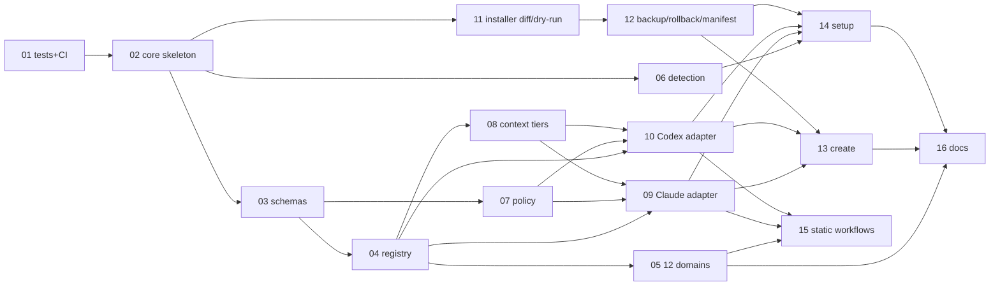

# 08 — Implementation Roadmap

| Field | Value |
|---|---|
| Status | Draft for review. Phase scope approved ([EXECUTION-SPECIFICATION §9](EXECUTION-SPECIFICATION.md)); sequencing proposed. |
| Date | 2026-11-23 |
| Related | [04 Product](04-product-specification.md) · [05 Architecture](05-architecture-specification.md) · [07 Migration](07-migration-strategy.md) · [09 Testing](09-testing-and-benchmark-strategy.md) |

## 1. Purpose and scope

This document defines a dependency-aware delivery sequence for V2.0, V2.1 and V2.2, with exit
criteria.

**Out of scope:** dates and staffing. Durations are not estimated, because there is no velocity data
for this codebase.

Work item IDs: `W0.x` (V1.x track), `W2.0-xx`, `W2.1-xx`, `W2.2-xx`.

## 2. V1.x maintenance track (proposed)

**Status: not approved.** This is recommended because the V1 defects affect current users now
([03](03-technical-debt.md)).

| ID | Item | Resolves |
|---|---|---|
| W0.1 | Remove machine paths; narrow the allow-list in shipped `settings.json` | TD-01 |
| W0.2 | Honour `-f`, `--db`, `--tier`; read version from `package.json` | TD-04, TD-16 |
| W0.3 | Hooks read stdin JSON; secret scan blocks with exit 2; lifecycle hooks on `SessionEnd` | TD-03 |
| W0.4 | Install config from the packaged `templates/.claude` instead of `degit` HEAD | TD-02 |

## 3. Phase V2.0: Foundation

**Goals:** Universal Core skeleton, canonical contracts, all 12 domains defined, Core separated from
adapters, safe installation, V1 compatibility.

| ID | Deliverable (spec #) | Depends on | Acceptance |
|---|---|---|---|
| W2.0-01 | Test foundation + CI + **V1 characterization snapshots** (14) | — | CI runs on 3 OSes; V1 golden files captured from `51bfc3a`-equivalent output |
| W2.0-02 | Modular Core skeleton, contracts, dependency rule check (1) | 01 | Core-imports-adapter check fails the build when violated |
| W2.0-03 | Versioned schemas: envelope + Domain, Capability, Agent, Skill, Rule, Workflow, Tool, Profile, manifest, GateResult contract (3, 5) | 02 | Schemas published in `catalog/schemas/`; contract tests |
| W2.0-04 | Registry loader + `catalog validate` | 03 | Detects invalid refs, cycles, duplicate IDs |
| W2.0-05 | **12 domain catalog foundations** at L0, plus V1 assets migrated as entries (4) | 03, 04 | 12/12 domains and all capability IDs validate; V1 assets mapped ([07 §2](07-migration-strategy.md#2-v1-asset-mapping)) |
| W2.0-06 | Project detection foundation (2) | 02 | Detection fixtures (V1 stacks + Python, Java, Go, .NET) pass |
| W2.0-07 | Policy Engine (static) + mandatory safety set | 03 | Policy snapshot tests; destructive patterns never in `allow` |
| W2.0-08 | Context tiers (static) + byte budgets | 04 | `doctor --context` reports measured T0 bytes per adapter |
| W2.0-09 | Claude Code adapter (6) | 04, 07, 08 | Golden tests; generated files validate against documented formats ([05 §10.2](05-architecture-specification.md#102-host-capability-matrix-verified-2026-11-23)) |
| W2.0-10 | Codex adapter (7) | 04, 07, 08 | Golden tests; `AGENTS.md` ≤ budget; trust notice emitted |
| W2.0-11 | Installer core: op planning, ownership classes, diff, dry-run (10, 11) | 02 | Dry-run zero-write test |
| W2.0-12 | Backup, atomic apply, rollback, manifest, `doctor` (12) | 11 | Rollback byte-identity; idempotency |
| W2.0-13 | `create` workflow, V1-compatible CLI (8) | 09, 10, 12 | V1 invocation table ([07 §3](07-migration-strategy.md#3-cli-compatibility)) passes |
| W2.0-14 | `setup` workflow, incl. V1 adoption (Path A–C) (9) | 06, 09, 10, 12 | Adoption makes zero writes; conflict fixtures pass |
| W2.0-15 | Static workflows: V1 commands as `wf.*` for both hosts | 05, 09, 10 | `spec → plan → build → test → review` invocable in both hosts |
| W2.0-16 | Migration docs + generated catalog reference (13) | 05, 13, 14 | Docs link-check PASS |

**V2.0 exit criteria** (EXECUTION-SPECIFICATION §9, made testable):

| Criterion | Evidence |
|---|---|
| All 12 domains validate against the canonical schema | `catalog validate` PASS in CI |
| Core does not import provider-specific modules | Dependency rule test PASS |
| Both adapters have documented capability mappings | [05 §10.3–10.4](05-architecture-specification.md#103-claude-code-adapter-mapping) + generated mapping doc |
| Setup detects existing configurations | Detection fixtures with `.claude/`, `AGENTS.md`, `.codex/`, `.mcp.json`, V1 projects |
| Installation is idempotent | Second run produces 0 operations |
| Dry-run does not modify files | Before/after hash equality |
| Rollback is verifiable | Byte-identity test across the conflict fixture matrix |
| V1 users have a migration path | [07](07-migration-strategy.md) + Path A–C fixture tests |

## 4. Phase V2.1: Intelligence and Orchestration

**Goals:** understand the project and intent; select the minimal relevant capabilities; coordinate
roles when needed.

| ID | Deliverable (spec #) | Depends on | Acceptance |
|---|---|---|---|
| W2.1-01 | Project Intelligence: module map, risk areas (1) | W2.0-06 | Fixture repos produce the expected model |
| W2.1-02 | Impact Analysis (7) | 01 | Changed-file → affected-module tests |
| W2.1-03 | Task Planner (classification) | W2.0-05 | Classification eval set accuracy reported ([09 §4](09-testing-and-benchmark-strategy.md#4-routing-and-context-evaluation-v21)) |
| W2.1-04 | Context Engine (dynamic ranking) (2) | W2.0-08, 03 | Context relevance eval |
| W2.1-05 | Hybrid Agent Router + minimality constraint (3) | 03, 04, W2.0-07 | Simple tasks yield ≤ 1 agent on the eval set |
| W2.1-06 | Manual override + precedence + conflict handling (4) | 05 | Every row of [05 §7.4–7.5](05-architecture-specification.md#74-override-precedence) has a test |
| W2.1-07 | Explainability record + `explain` (5) | 05 | 8 questions answered for 100% of plans |
| W2.1-08 | Cost-aware selection (estimates) (6) | 05 | Budget behaviour per mode tested |
| W2.1-09 | Workflow Orchestrator (dynamic) + cross-domain dependencies (8, 9) | 05, 06 | Multi-domain eval tasks produce valid step graphs |
| W2.1-10 | Router delivery to hosts (ADR-009 once decided) | 05, 09 | Both hosts can obtain and follow a plan |
| W2.1-11 | Context and routing evaluation suite (10) | 03–05 | Suite in CI with a tracked baseline |

**Exit criteria:** simple tasks trigger no unnecessary agents; multi-domain tasks select appropriate
capabilities; manual overrides are respected; mandatory policies cannot be bypassed (negative tests);
every routing decision is explainable; context loading is task-relevant (measured by the eval suite).

## 5. Phase V2.2: Quality, Evaluation and Performance

| ID | Deliverable (spec #) | Depends on | Acceptance |
|---|---|---|---|
| W2.2-01 | Quality Gate Engine + evidence capture (1, 2) | V2.1 | No PASS without evidence (property test) |
| W2.2-02 | Evaluation framework (3) | W2.1-11 | Runs arms baseline, V1 and V2 under identical controls |
| W2.2-03 | Benchmark fixtures + ≥ 30-task suite (4, 5) | 02 | [09 §5.3](09-testing-and-benchmark-strategy.md#53-task-suite) distribution met |
| W2.2-04 | Token and cost tracking (measured where the host exposes it) (6) | W2.1-08 | Every figure labelled measured or estimated |
| W2.2-05 | Execution reports (7) | 01, 04 | Report schema validated |
| W2.2-06 | Regression detection (8) | 02, 03 | Detects seeded regressions in the eval set |
| W2.2-07 | Performance analysis (9) | 03, 04 | Report per KPI ([09 §6](09-testing-and-benchmark-strategy.md#6-metrics-and-kpis)) |
| W2.2-08 | Documentation and release readiness (10) | all | Release checklist gates PASS |

**Exit criteria:** every quality result has evidence or is NOT_VERIFIED; benchmark conditions are
reproducible; V1 and V2 are compared under equivalent conditions; cost is measured per accepted
outcome; security and data-loss regressions override aggregate scores.

## 6. Domain depth by phase

Levels are defined in [05 §6.8](05-architecture-specification.md#68-domain-depth-levels). These are
targets, not commitments of content quality.

| Domain | V1 (est.) | V2.0 | V2.1 | V2.2 |
|---|---|---|---|---|
| D01 Product & Business | L2 | L2 | L2 | L3 |
| D02 Design & UX | L1 | L1 | L2 | L2 |
| D03 Frontend | L2 | L2 | L2 | L3 |
| D04 Backend | L2 | L2 | L2 | L3 |
| D05 Mobile | L2 | L2 | L2 | L3 |
| D06 Data & AI/ML | L1 | L1 | L2 | L2 |
| D07 DevOps, Cloud & SRE | L1 | L1 | L2 | L2 |
| D08 Quality | L2 | L2 | L2 | L3 |
| D09 Security & Compliance | L1–L2 | L2 | L2 | L3 |
| D10 Architecture & Leadership | L2 | L2 | L2 | L3 |
| D11 Docs & DevEx | L0–L1 | L1 | L2 | L2 |
| D12 Integration & Automation | L0–L1 | L1 | L1 | L2 |

Every domain is at least L0 in V2.0 (required). The table shows L1 for all of them because V1 assets
or simple skills exist. Reaching L2 in D02, D06, D07 and D11 requires new content authoring, which is
a resourcing question (OQ-05).

## 7. Future phases (not V2 commitments)

Additional host adapters; enterprise policy management; advanced domain workflows; shared team
catalogs; optional cloud collaboration; IDE integrations; distribution as host plugins (Claude Code
and Codex both support plugins; this is not a marketplace, see OQ-06).

## 8. Acceptance criteria for this roadmap

- [x] V2.0, V2.1 and V2.2 deliverables match EXECUTION-SPECIFICATION §9.
- [x] All 12 domains have a V2.0 foundation.
- [x] Dependencies and exit criteria are documented.
- [x] Advanced depth is phased.
- [ ] Approved by the maintainer, including the V1.x track. **Pending.**

## 9. Implementation status

Branch `feature/v2-foundation` (not merged, not committed). Updated 2026-11-24 (fifth batch).

| Item | Status | Evidence |
|---|---|---|
| W2.0-01 Test foundation + CI + V1 characterization | Done (CI not yet run remotely) | `vitest.config.mts`, `.github/workflows/ci.yml`; `tests/characterization/` (9 snapshot cases CH-1–CH-9, plus CH-10 and defect assertions for F-02, F-04, F-05, F-06, F-10) |
| W2.0-02 Core skeleton, contracts, dependency rule check | Done: contracts, dependency and host-format rule checks; Core modules present: project-detection, policy, context | `src/core/`, `tests/architecture/dependency-rules.test.ts` |
| W2.0-03 Versioned schemas | Done | `catalog/schemas/*.schema.json` (envelope, 8 kinds, gate-result, manifest); `tests/contract/` |
| W2.0-04 Registry loader + `catalog validate` | Done | `src/registry/`, `src/cli/catalog-validate.ts`, `npm run catalog:validate`; `tests/unit/` |
| W2.0-05 12 domain catalog foundations | Done: 12 domains at L0, 123 capabilities, 9 canonical agents; V1 assets migrated (10 aliases, 14 skills, 17 rules, 9 workflows, 3 profiles, 17 tools, 8 references) with bodies verified byte-for-byte; `code-review`/`tdd` merge pending review | `catalog/`; `tests/catalog/domain-foundation.test.ts`, `tests/catalog/v1-migration.test.ts` |
| W2.0-06 Project detection foundation | Done: stack detection in Core (JS/TS, Python, Java/Kotlin, Go, .NET, Rust, Ruby, PHP, Flutter, native mobile, CI, containers, workspaces); host config and V1 fingerprint in adapters | `src/core/project-detection/`, `src/adapters/{claude-code,codex}/`; `tests/unit/core/project-detection.test.ts`, `tests/unit/adapters/` |
| W2.0-07 Policy Engine (static) + mandatory safety set | Done: `policy.safety` (mandatory) + `policy.default-project`; narrow-only evaluation with explanation trail | `catalog/policies/`, `src/core/policy/`, `src/registry/policies.ts`; `tests/unit/core/policy-engine.test.ts` |
| W2.0-08 Context tiers (static) + byte budgets | Done for catalog bodies: T0 for the standard profile = **13,542 bytes measured** (5 always-scoped rules) vs about 113 KB of rules that V1 loads at every launch (F-18); within the 24 KiB Codex budget. Adapter preambles are not yet included; Claude Code budget not set (OQ) | `src/core/context/`, `src/registry/knowledge.ts`; `npm run catalog:validate` prints T0 per profile |
| W2.0-09 Claude Code adapter | Done (host smoke test NOT_VERIFIED: no `claude` binary on the build machine): 66 files for profile.standard, V1 agent and command names kept, least-privilege `settings.json` (ask/deny only), working policy hook, `.mcp.json` opt-in | `src/adapters/claude-code/`, `src/adapters/common/`; `tests/golden/adapters.test.ts` + `__snapshots__/claude-code.json` |
| W2.0-10 Codex adapter | Done (host smoke test NOT_VERIFIED: no `codex` binary): 62 files, `AGENTS.md` managed section 16,871 bytes within the 24 KiB budget (generation fails above budget), TOML agents and config, hook with exit 2, trust notice | `src/adapters/codex/`; `tests/golden/` + `__snapshots__/codex.json` |
| Policy hook runtime (part of W2.0-09/10, fixes TD-03) | Done: runs as a real process in an ESM project; end-to-end tests for ask, deny and Codex patches | `src/adapters/hook-runtime/`, `src/app/policy-hook-assets.ts`; `tests/e2e/policy-hook.test.ts` |
| W2.0-11 Installer core: planning, ownership classes, diff, dry-run | Done: read-only plan with 5 ownership classes and unified diffs; conflict strategies with `write-new` as default; dry-run makes zero writes (hash-checked) | `src/installer/{plan,diff,apply-in-memory}.ts`; `tests/installer/`, `tests/unit/installer/` |
| W2.0-12 Backup, atomic apply, rollback, manifest, doctor | Done: write-ahead journal, backups, atomic writes with verification, automatic rollback on failure (tested by locking a directory), manual rollback byte-identical, stale-plan guard, doctor | `src/installer/{apply,transaction,rollback,doctor,manifest}.ts`; `tests/installer/installer.test.ts` |
| W2.0-13 `create` workflow, V1-compatible CLI | Done: `bin/cli.js` launcher → `src/cli/`; commands `create` (default), `setup`, `diff`, `doctor`, `rollback`, `catalog validate`; V1 flags and prompts kept, F-02–F-06 and F-11 fixed (07 §3.1) | `src/cli/`, `src/app/{create,templates}.ts`; `tests/e2e/cli.test.ts`, `tests/unit/cli/` |
| W2.0-14 Setup workflow | Done (CLI `setup` with `--dry-run`, `--yes`, `--strategy`, `--adapter`, `--profile`, `--enable-tool`; refuses to write without `--yes` when not interactive). Not done: `pristine-v1` replacement of unmodified V1 files | `src/app/setup.ts`; `tests/e2e/setup.test.ts`, `tests/e2e/cli.test.ts` |
| W2.0-15, W2.0-16 | Not started: verifying static workflows inside real hosts (needs `claude`/`codex` binaries), README/CHANGELOG and migration guide for users | — |

Working assumptions adopted to start (reversible until merge): ADR-010 (YAML + JSON Schema) and
ADR-011 (TypeScript) from [10 §4](10-architecture-decisions.md#4-proposed-decisions-not-approved).
Dev tooling requires Node ≥ 20 (Vitest 4). The runtime minimum is still OQ-07.
